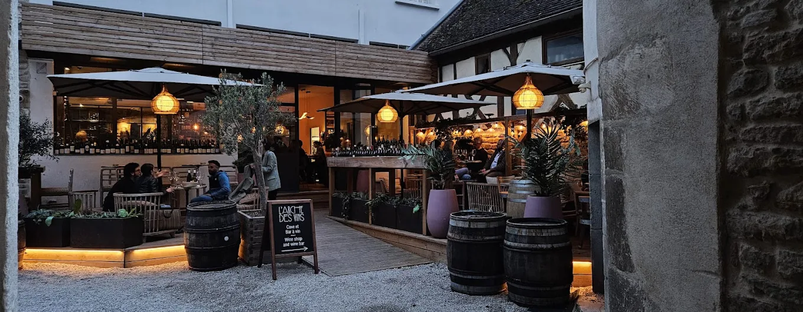

Beaune is de beste uitvalsbasis voor een wijnreis door de Bourgogne. In het centrum zitten tientallen wijnbars, en binnen een half uur rijden ben je in de bekende wijndorpen van de Côte d'Or. Hieronder waar je in Beaune een glas drinkt, welke wijnhuizen je kunt bezoeken en waar je in de dorpen eet.

## De streek in het kort

De Côte d'Or is een smalle strook heuvels van zo'n vijftig kilometer. In het noorden ligt de **Côte de Nuits**, met dorpen als Gevrey-Chambertin en Vosne-Romanée en vooral rode wijn van pinot noir. In het zuiden ligt de **Côte de Beaune**, waar ook de grote witte wijnen van chardonnay vandaan komen, uit Meursault, Puligny- en Chassagne-Montrachet. Chablis ligt apart, meer dan een uur rijden naar het noorden, met strakke chardonnay op kalkbodem.

## Wijnbars in Beaune

[L'Arche des Vins](/locations/larche-des-vins) zit in een middeleeuws straatje en is wijnbar en wijnwinkel in één, met Franse gerechten en een terras. [La Dilettante](/locations/la-dilettante) in de Rue du Faubourg Bretonnière is open voor lunch, diner en een laat glas, met kleine gerechten. Aan de rand van het centrum heeft [Le Bout du Monde](/locations/la-bout-du-monde) een grote kelder met veel Bourgogne en een terras voor na een lange dag proeven. [Le Comptoir des Tontons](/locations/le-comptoir-des-tontons), met de rode gevel, is bistro, wijnbar en wijnwinkel tegelijk.

Aan de Place Ziem zit [Bistrot du Coin](/locations/bistrot-du-coin), een klein wijncafé waar de eigenares graag met je meedenkt over welke domeinen je kunt bezoeken. [La Maison du Colombier](/locations/la-maison-du-colombier) is een gastrobar met veel wijn en tapas, waar je ook kunt overnachten. Wil je na een dag Bourgogne iets anders, dan heeft [Enstase](/locations/enstase) bao's en tapas. Bij [Loiseau des Vignes](/locations/loiseau-des-vignes), vlak bij de Hospices, kun je kiezen uit 32 wijnen per glas uit vier klimaatkasten.

## Proeven in Beaune

Bij [Maison Denis Perret](/locations/maison-denis-perret) aan de Place Carnot kun je de wijnen van vijf grote négociants proeven, waaronder Bouchard, Drouhin en Jadot. Onder de kasseien van Beaune liggen de kelders van [Patriarche](/locations/patriarche-père-et-fils), vijf kilometer gangen met meer dan twee miljoen flessen. Je loopt er zelf rond met een audiogids. Kleiner is [Coudurier Jung](/locations/vins-coudurier-jung), een stadswijnmakerij met een kelder van een handvol vaten, zonder filtratie en met weinig sulfiet. [Domaine des Croix](/locations/domaine-des-croix) ontvangt op afspraak, behalve in september en oktober.

## De Côte de Beaune

In Meursault schenkt het [Caveau de l'Hôtel Les Charmes](/locations/caveau-de-lhotel-les-charmes) bijna 500 wijnen, waaronder alle premiers crus van Meursault, tegen winkelprijs plus €10. Even verderop eet je bij [Le Soufflot](/locations/le-soufflot), in een oud wijnboerenhuis. In een zijstraatje van Chassagne-Montrachet zit [Colette](/locations/colette), een wijnbar met een kelder waar je ook flessen kunt kopen tegen goede prijzen.

In Savigny-lès-Beaune werkt [Chandon de Briailles](/locations/chandon-de-briailles) sinds 2005 biodynamisch, met wijngaarden in drie dorpen. [Domaine Rapet](/locations/domaine-rapet-père-fils) in Pernand-Vergelesses, aan de voet van de Corton, maakt al meer dan 250 jaar wijn. In Auxey-Duresses legden monniken van Cluny in 962 de wijngaarden aan van [Le Clos du Moulin aux Moines](/locations/le-clos-du-moulin-aux-moines), met een windmolen boven de stokken. En bij [Réserve de Bacchus](/locations/reserve-de-bacchus) in Ladoix-Serrigny staan meer dan 1.000 wijnen, handig om aan het eind van je reis een paar flessen mee te nemen.

## De Côte de Nuits en Chablis

In Vosne-Romanée opende Louis-Michel Liger-Belair in 2022 [La Cuverie](/locations/la-cuverie-de-vosne), een ontmoetingsplek met uitzicht op de Clos du Château. [Domaine Trapet](/locations/domaine-trapet) in Gevrey-Chambertin ontvangt maximaal vier personen per keer, met een Bourgondische maaltijd en vijf wijnen.

In Chablis zit [Chablis Wine Not](/locations/chablis-wine-not) in een oude apotheek, en daar drinken ook de wijnmakers zelf. [Domaine Duplessis](/locations/domaine-duplessis) heeft premiers crus en grand cru Les Clos, van stokken die op veel percelen 75 jaar of ouder zijn.

## Tip

Bij de meeste kleine domeinen in de Bourgogne moet je een afspraak maken, en tijdens de oogst in september en oktober ontvangen veel huizen geen bezoek. In de wijnbars van Beaune en Meursault proef je de wijnen van domeinen die je niet kunt bezoeken. Alle adressen staan ook in de [gids Bourgogne](/wijnreis/bourgogne).
