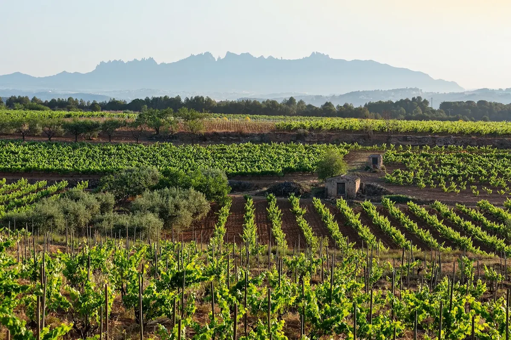

Op een uur rijden van Barcelona ligt de Penedès, waar de meeste Spaanse mousserende wijn vandaan komt. Cava wordt gemaakt zoals champagne, met een tweede gisting in de fles, maar van andere druiven: vooral xarel·lo, macabeo en parellada. Veel van de beste huizen werken biologisch of biodynamisch, en een aantal is uit de DO Cava gestapt om strengere eigen regels te volgen. Hieronder de wijnhuizen die je kunt bezoeken.

## Sant Sadurní d'Anoia

Sant Sadurní is de hoofdstad van de cava, en veel huizen hebben hun kelders midden in het stadje. Onder [Recaredo](/locations/recaredo) ligt de kelder die Josep Mata Capellades in 1924 onder zijn huis begon te bouwen. Alle wijnen zijn brut nature, zonder toegevoegde suiker, uit één oogstjaar en met de hand gedegorgeerd. Bij [Juvé & Camps](/locations/juvé-camps) loop je door zes verdiepingen tunnels, waar de flessen nog met de hand worden gedraaid.

Ook [Jaume Giró i Giró](/locations/jaume-giró-i-giró), met de gele gevel, en [Cava Blancher](/locations/blancher-capdevila-pujol) aan de Plaça del Pont Romà zitten midden in het centrum, met kelders op meerdere verdiepingen onder de grond. Net buiten het stadje maakt [Celler Kripta](/locations/celler-kripta) de Kripta, een mousserende wijn in een fles in de vorm van een amfora, die zo'n acht jaar rijpt.

## Gelida en Subirats

[Torelló](/locations/torelló-viticultors) in Gelida heeft documenten tot 1395 terug en 23 generaties wijnbouw, met 135 hectare biologische wijngaarden rond twee middeleeuwse masia's. In Subirats heeft [Sumarroca](/locations/sumarroca) biologische wijngaarden op een groot landgoed tussen Sant Sadurní en Monistrol d'Anoia. In Sant Pau d'Ordal werd [Albet i Noya](/locations/albet-i-noya) de eerste biologische wijnmaker van Spanje. Na het proeven eet je in hetzelfde dorp bij [Cal Xim](/locations/cal-xim), waar ze al meer dan vijftig jaar lamskoteletjes grillen op eikenhout.

## De rest van de Penedès

[Parés Baltà](/locations/parés-baltà) in Pacs del Penedès maakt al sinds 1790 wijn. Het domein is biodynamisch, en op de landgoederen grazen eigen schapen. [Can Ràfols dels Caus](/locations/can-ràfols-dels-caus) in het Garraf-massief begon xarel·lo op kastanjehouten vaten te vergisten. [Caves Bolet](/locations/caves-bolet) in Castellví de la Marca werkt sinds 2003 biologisch, en je kunt er overnachten in een modernistisch huis uit 1911. [Heretat Baltà de Cela](/locations/heretat-baltà-de-cela) in Guardiola de Font-rubí maakt een mousserende wijn van alleen xarel·lo die vijf jaar rijpt. [Jean Leon](/locations/jean-leon) in Torrelavit maakte als eerste wijnhuis in Spanje een wijn van alleen cabernet sauvignon.

## Rond Barcelona

In Alella, vijftien kilometer ten noorden van Barcelona, staat [Alella Vinícola](/locations/alella-vinícola) in een modernistisch gebouw van een leerling van Gaudí. Wie verder het binnenland in wil, kan naar [Abadal](/locations/abadal) in de Bages, waar de witte picapoll groeit.

## Tip

De meeste wijnhuizen ontvangen alleen op reservering. Met de trein ben je vanuit Barcelona in een uur in Sant Sadurní, waar je verschillende kelders te voet kunt bezoeken. Alle adressen staan ook in de [gids Barcelona & Penedès](/wijnreis/barcelona-penedes).
