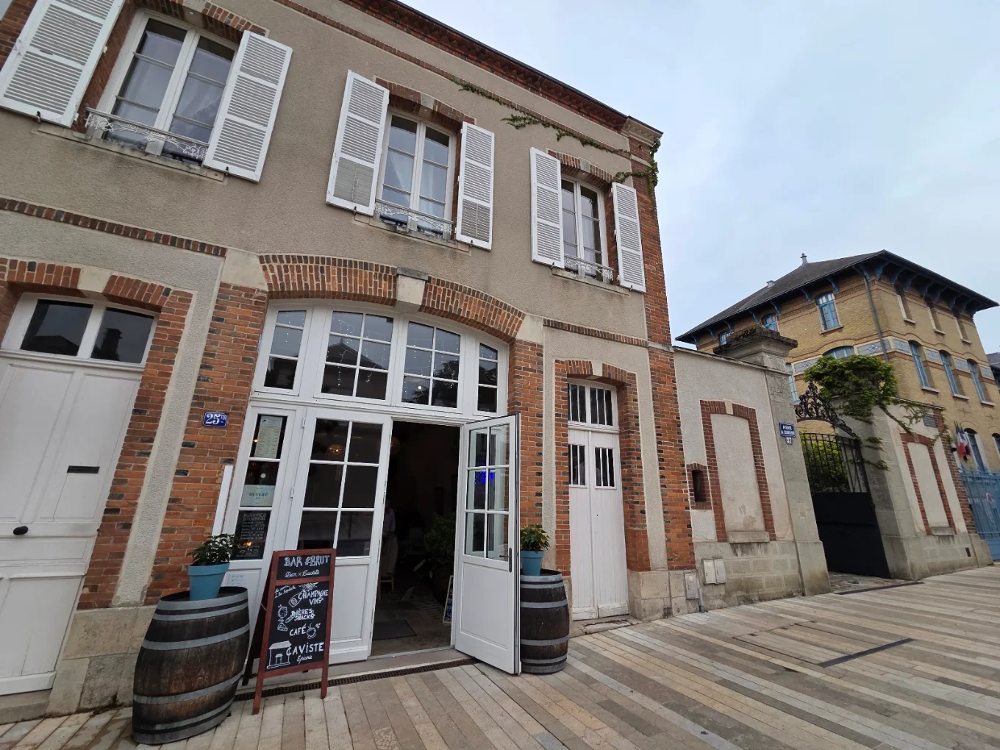
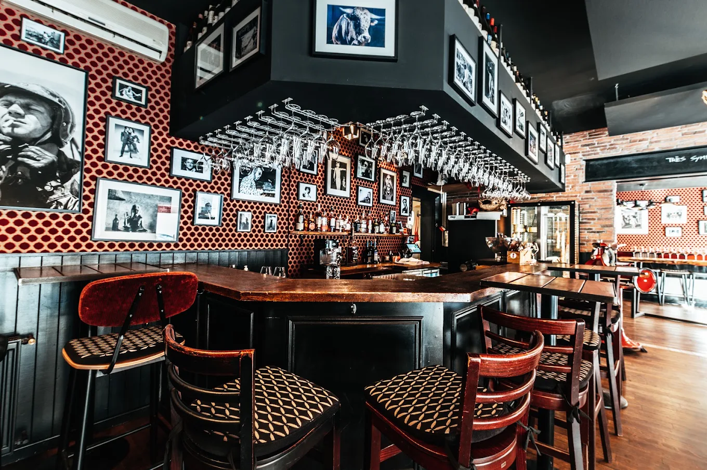
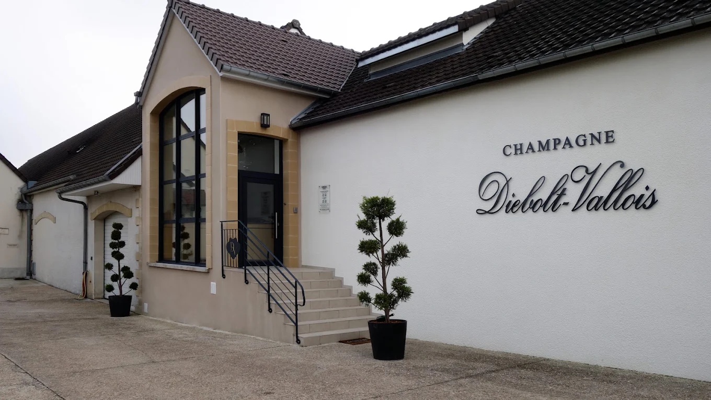

De Champagne ligt op zo'n vier uur rijden van Utrecht, met Reims en Épernay als middelpunt. De grote huizen aan de Avenue de Champagne kun je bezoeken, maar het leukst zijn de kleine wijnmakers die hun eigen druiven verbouwen: de growers, of vignerons. Hun champagne proef je in de wijnbars van Reims en Épernay, of bij de wijnmaker thuis.

## De streek in het kort

Er zijn drie belangrijke gebieden. Op de **Montagne de Reims**, tussen Reims en Épernay, groeit vooral pinot noir, en die geeft champagne met body. In de **Côte des Blancs**, ten zuiden van Épernay, staat bijna alleen chardonnay, voor strakke en frisse blanc de blancs. In de **Vallée de la Marne**, ten westen van Épernay, staat veel meunier, wat fruitige champagne geeft. Van de meer dan 300 wijndorpen hebben er maar 17 de status grand cru, zoals Aÿ, Ambonnay, Cramant, Avize en Chouilly.

## Épernay

Aan de Avenue de Champagne, tussen de grote huizen, schenkt [#Brut](/locations/brut) alleen champagne van growers. Een paar minuten lopen verderop zit [L'Atypique](/locations/latypique), een champagnebar in een binnentuin, met livemuziek. Bij [Le 520](/locations/520) kun je kiezen uit 650 cuvées van meer dan 180 huizen en vignerons. Elke zaterdagochtend is er een gratis proeverij met een wijnmaker.

Verderop aan de laan doet [Leclerc Briant](/locations/champagne-leclerc-briant) het bewust anders: alleen op afspraak, in groepjes van maximaal zes, met kelders op 35 meter diepte en uitzicht over Épernay vanaf het rooftopterras.

Om te eten reserveer je op tijd bij [La Cave à Champagne](/locations/la-cave-a-champagne), een familiebistro met veel champagne van growers op de kaart. Vraag om een tafel in het hoofdgedeelte. [L'Oben](/locations/loben) is klein, met plek voor 26 gasten, en zit vaak vol met mensen uit de buurt. [Sacré Bistro](/locations/sacre-bistro) combineert burgers met champagne, als tussenstop tussen twee kelderbezoeken. Tegenover het park van het stadhuis combineert [Pierre Mignon](/locations/champagne-pierre-mignon) champagne met eten: sommelier Denis Garret stelt combinaties samen met kaas, vleeswaren, zalm of kaviaar.

## Reims

In Reims zitten de champagnebars bij elkaar in het centrum. [Le Coq Rouge](/locations/le-coq-rouge) is klein en altijd druk, met wijnen en champagnes die het team zelf bij de makers uitkiest. [Le Wine Bar by Le Vintage](/locations/le-wine-bar-by-le-vintage) aan de Place du Forum heeft meer dan 500 wijnen en 200 champagnes. Ernaast opende Aude Henon in 2025 [La Vertu](/locations/la-vertu), met alleen champagne en wijn van kleine producenten. [Le Clos](/locations/le-clos) zit verstopt in een binnentuin bij de markthal, met een groot terras in de zomer.

Aan de voet van de kathedraal heeft [Cave du 13OR](/locations/cave-du-13or) een champagnebar en een winkel met 200 champagnes. Bij [Les Caves du Forum](/locations/les-caves-du-forum) loop je een stenen trap af naar drie kelders uit de zestiende eeuw, negen meter onder de grond.

## Wijnhuizen bezoeken

In de Côte des Blancs maakt [Diebolt-Vallois](/locations/diebolt-vallois) in Cramant blanc de blancs van stokken die in 1950 zijn geplant. In Chouilly maakt [Cyrill Banchet](/locations/cyrill-banchet) chardonnay op grand-cru-krijt. In Avize kun je bij [Le Recommandé](/locations/le-recommande) kiezen uit meer dan 400 champagnes van kleine growers uit de Côte des Blancs, in het dorp waar ze gemaakt worden. In Pierry, aan de rand van Épernay, bewerkt coöperatie [Vincent d'Astrée](/locations/champagne-vincent-dastree) zo'n 85 hectare premier cru op de Coteaux Sud d'Épernay.

Op de Montagne de Reims maakt [Gatinois](/locations/gatinois) in Aÿ alleen grand cru, voor 90% pinot noir, en zo'n 50.000 flessen per jaar. [Egly-Ouriet](/locations/champagne-egly-ouriet) in Ambonnay laat de champagne drie tot vier jaar rijpen, veel langer dan de meeste makers. [Champagne Gardet](/locations/champagne-gardet) in Chigny-les-Roses is een klein huis met meerdere proeverijen. [Roger Coulon](/locations/roger-coulon) in Vrigny werkt biologisch, zonder filtratie, met de achtste en negende generatie.

In het premier cru-dorp Rilly-la-Montagne is [Michel Fagot](/locations/champagne-michel-fagot) al vier generaties een familiedomein. In Tauxières-Mutry leidt Charlotte van [Leblanc-Collard](/locations/champagne-leblanc-collard) je zelf rond door de kelder en de wijngaard. In Aÿ, naast Gatinois, rijdt James van [Richard-Fliniaux](/locations/champagne-richard-fliniaux) je in een elektrische auto langs de grand cru-wijngaarden, die sinds 2015 op de Werelderfgoedlijst staan.

In Hautvillers, het dorp van Dom Pérignon, ontvangt [G. Tribaut](/locations/g-tribaut) bezoekers zonder ingewikkelde afspraken. Je eet er in [Le Beau Lieu](/locations/le-beau-lieu), waar je een fles betaalt voor de winkelprijs en een klein kurkengeld. In de Vallée de la Marne liggen [Bochet-Lemoine](/locations/champagne-bochet-lemoine) in Cormoyeux en [Le Bateau Lavoir](/locations/le-bateau-lavoir) in Damery, aan de Marne, een goed adres om te lunchen tijdens een fietstocht. Ook in de Vallée de la Marne laat [Charlier et fils](/locations/champagne-charlier-et-fils) in Châtillon-sur-Marne alle champagne op houten vaten rijpen. In Boursault maakt [Le Gallais](/locations/champagne-le-gallais) champagne binnen de ommuurde clos van een kasteel dat ooit aan weduwe Clicquot toebehoorde.

## Tip

Bij de meeste kleine wijnhuizen moet je van tevoren een afspraak maken. Plan er niet meer dan twee of drie per dag, en drink in de wijnbars van Reims en Épernay de champagnes van makers die je niet kunt bezoeken. Alle adressen staan ook in de [gids Champagne](/wijnreis/champagne).
