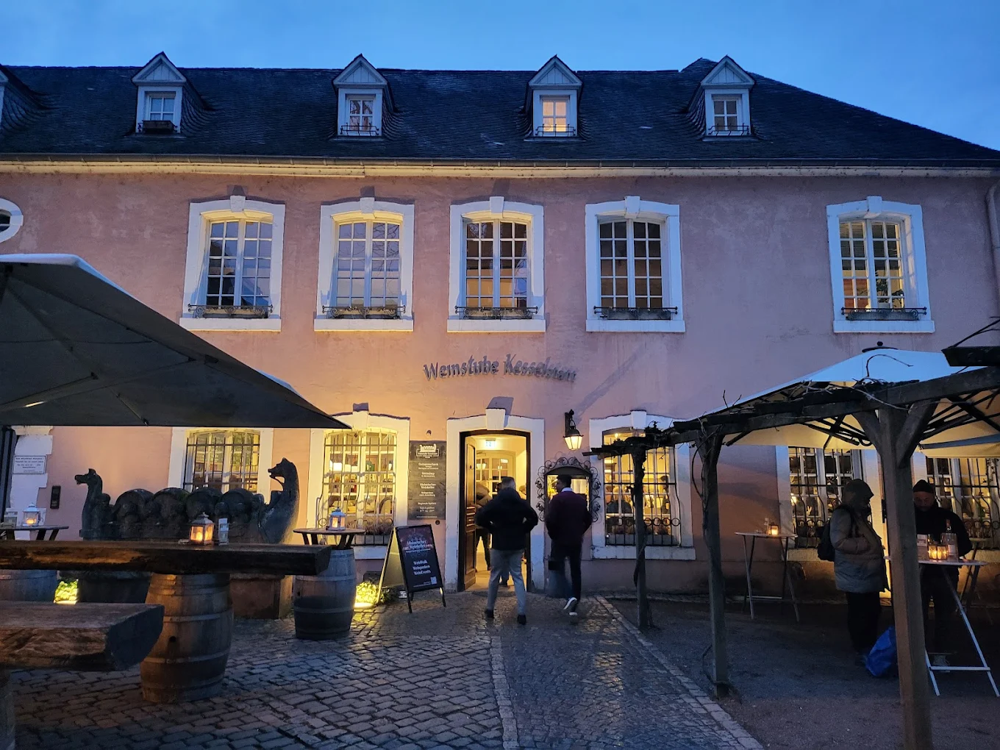
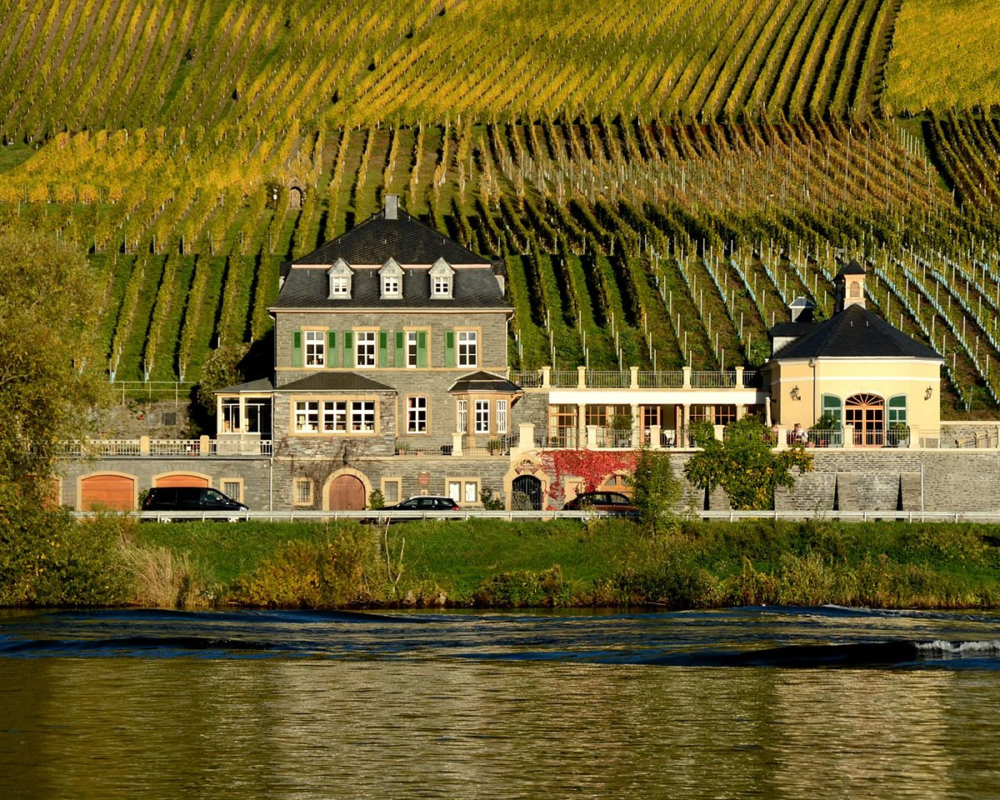
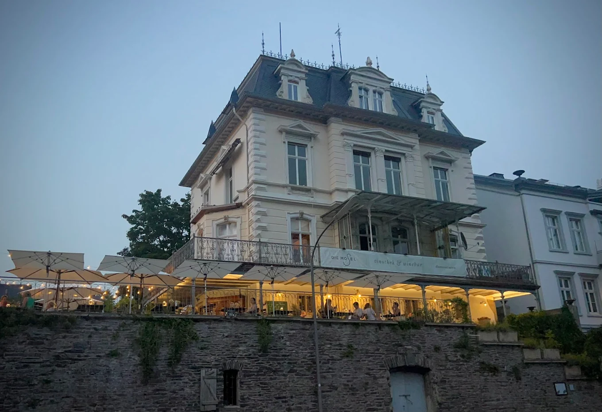

De Moezel slingert van Trier naar Koblenz, met wijngaarden op leisteenhellingen die soms zo steil zijn dat alles met de hand moet. Vrijwel overal staat riesling, van kurkdroog tot zoet, met weinig alcohol en veel zuren. Vanuit Nederland ben je er in vier tot vijf uur. Hieronder de adressen, van stroomopwaarts naar stroomafwaarts.

## Riesling van de Moezel

De beste wijngaarden liggen op zuidhellingen langs de rivier, waar het water en de donkere leisteen de warmte vasthouden. Op het etiket staat vaak hoe rijp de druiven waren: kabinett is licht en fris, spätlese en auslese zijn rijper en vaak wat zoeter. Wil je een droge wijn, kijk dan naar het woord **trocken**. De zijrivieren Saar en Ruwer horen ook bij de streek. Daar is de riesling vaak nog strakker.

## Trier en de Ruwer

Op het marktplein van Trier, met uitzicht op de Dom, heeft [Kesselstatt](/locations/kesselstatt) een Weinstube. Je proeft er riesling uit bekende wijngaarden van Moezel, Saar en Ruwer naast elkaar, zoals Piesporter Goldtröpfchen en Bernkasteler Doctor. [Bagatelle](/locations/bagatelle) ligt direct aan de Moezel, met een terras aan het water en een kaart vol riesling. Net buiten Trier, aan de Ruwer, ligt [Maximin Grünhaus](/locations/maximin-grunhaus), waar al bijna 2.000 jaar wijn wordt gemaakt, eerst door de Romeinen en daarna door monniken. Sinds 1882 is het landgoed van de familie Von Schubert.

## Bernkastel-Kues

Bernkastel is het mooiste wijnstadje aan de Moezel, met vakwerkhuizen en de Bernkasteler Doctor boven het centrum. [Dr. Loosen](/locations/weingut-dr-loosen) staat in de lijst van World's 50 Best Vineyards en heeft wijngaarden in de bekende lagen rond Bernkastel. [Dr. Pauly-Bergweiler](/locations/weingut-dr-pauly-bergweiler) heeft vijftien percelen tussen Brauneberg en Erden. Elke zaterdag om vier uur is er een proeverij met uitleg, ook in het Engels. Om te eten ga je naar [Graacher Tor](/locations/graacher-tor) in het middeleeuwse centrum. De eigenaar loopt zelf langs de tafels om je te helpen met de wijn.

## Traben-Trarbach en Cochem

In Traben-Trarbach kun je bij [Die Mosel Vinothek](/locations/die-mosel-vinothek-winebar) aan de promenade wijn proeven, kopen en eten, en er ook overnachten. In Cochem ontvangt de familie [Hieronimi](/locations/hieronimi) al meer dan 35 jaar gasten in gewelfde kelders aan de rivier. In de Weingarten zit je in ligstoelen aan het water, met uitzicht op de Reichsburg.

## Tip

Rijd de Moezel niet in één dag af: de weg volgt alle bochten van de rivier. Kies een uitvalsbasis zoals Bernkastel, en neem de fiets of de boot naar de dorpen in de buurt. Alle adressen staan ook in de [gids Mosel](/wijnreis/mosel).
