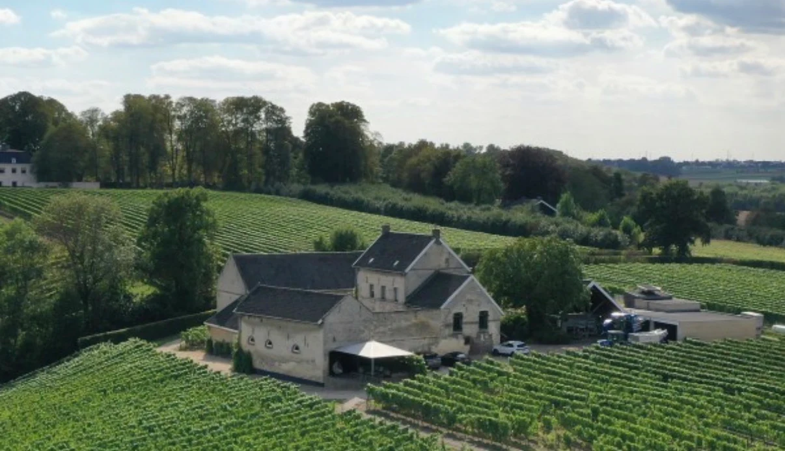
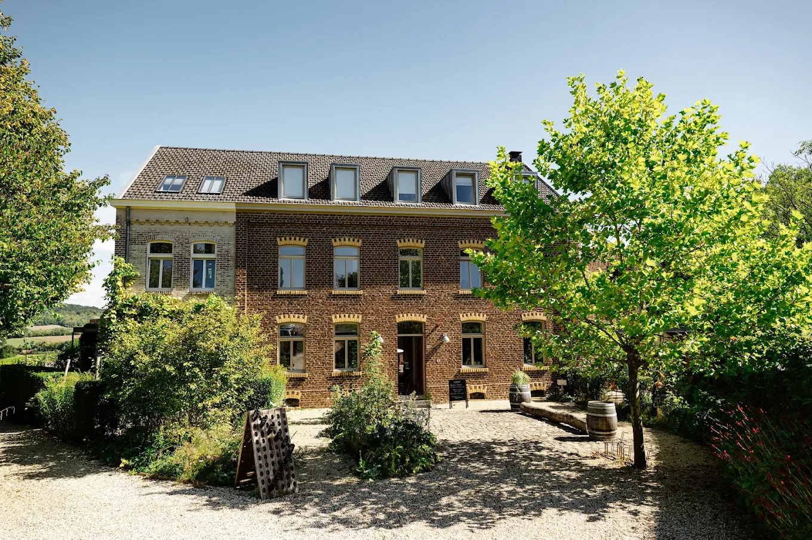
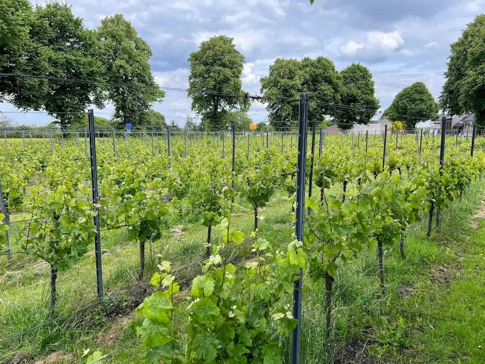
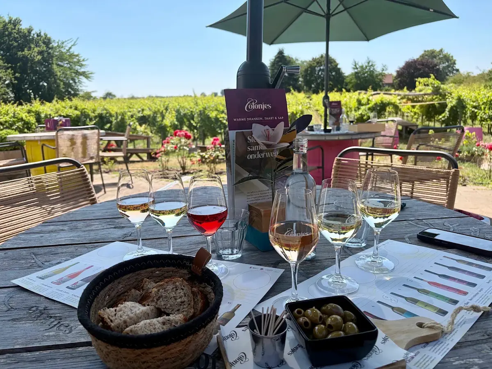
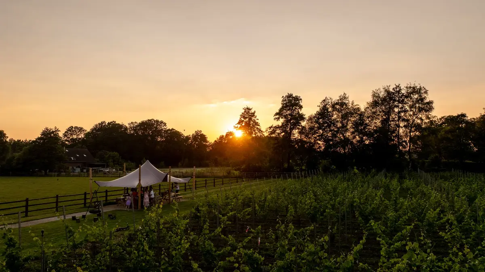
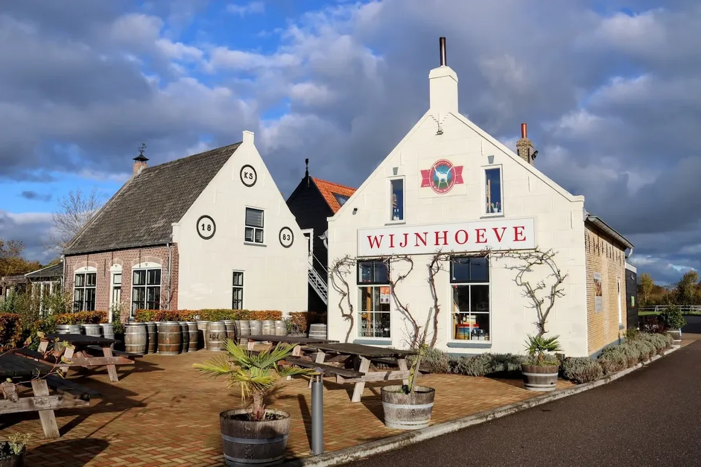
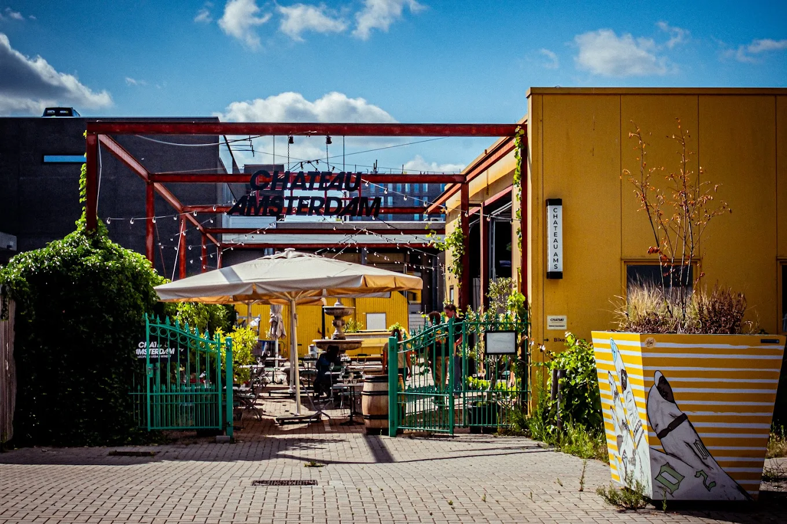

Nederlandse wijn? Jazeker — en het wordt met het jaar beter. Dit zijn de 25 wijndomeinen die op de wijnparade staan, van de oudste wijngaard van het land tot een heus wijnhotel en een nacht slapen in een wijnvat. Veel van deze domeinen werken met schimmelresistente druiven als solaris, johanniter en souvignier gris, die weinig of geen bespuiting nodig hebben.

## Zuid-Limburg: de bakermat van de Nederlandse wijnbouw

Op de Louwberg boven de Jekervallei ligt [De Apostelhoeve](/locations/de-apostelhoeve), de oudste wijngaard van Nederland, waar al sinds 1970 commercieel wijn wordt gemaakt. Je kunt er lopend of fietsend vanuit Maastricht komen; het domein is dagelijks behalve zondag open voor verkoop, en er zijn rondleidingen vanaf twaalf personen. Aan de andere kant van de stad ligt [Wijngoed hoeve Nekum](/locations/wijngoed-hoeve-nekum), een hoeve uit rond 1600 met wijnstokken sinds 1988; de rondleiding door wijngaard en kelder eindigt met een proeverij van vijf wijnen en Limburgse hapjes.

In Voerendaal maakt [Wijngoed Fromberg](/locations/wijngoed-fromberg) sinds 1994 wijn op een zuidhelling van mergel, en bracht het in 1996 de eerste Nederlandse mousserende wijn uit. Je proeft er op het terras met uitzicht, of combineert een kelderrondleiding met een wijnwandeling van 8 of 13 kilometer. [Domein Holset](/locations/domein-holset), bij Vaals en het drielandenpunt, maakt uitsluitend mousserende wijn in een circulair gebouwde boerderij; na een wandeling door de wijngaard proef je op het terras, en wie wil blijven slapen, kiest uit elf themakamers of een vakantiewoning voor acht personen.

In Sint Geertruid begonnen Marc en Eedsje Huynen in 2016 met 325 wijnstokken in hun achtertuin; inmiddels heeft [Wijndomein D'Hunes](/locations/wijndomein-dhunes) zeven hectare met elf druivenrassen en een proeflokaal met uitzicht op de wijngaard, plus een vakantiewoning voor acht personen. [Wijngoed Raar Saint Remi](/locations/wijngoed-raar-saint-remi) in Meerssen verwijst naar de monniken van Saint-Remi uit Reims, die hier al in de middeleeuwen wijngaarden hadden; de proeverij vindt plaats in de gewelfde kelder. Bij [Sterreheim](/locations/sterreheim) in Schinnen groeien klassieke druivenrassen rond een negentiende-eeuwse hoeve, en leveren de alpaca's op het erf de mest; proeverijen en rondleidingen zijn op reservering.

In het witte stadje Thorn, in Midden-Limburg, vertelt wijnmaker Harry Vorselen in het proeflokaal van [Wijngoed Thorn](/locations/wijngoed-thorn) over het wijnmaken — de witte wijnen zijn er een aanrader. [Wittemer Wijngaard Wahlwiller](/locations/wittemer-wijngaard-wahlwiller) is met 1971 een van de eerste moderne wijngaarden van Nederland, aangelegd door dokter Schepel uit Gulpen. Vlakbij, in Eys, ligt het biologische [Domein Aldenborgh](/locations/domein-aldenborgh), in 2005 verkozen tot Wijngaard van het jaar van beide Limburgen, en [Domaine Salamander](/locations/domaine-salamander), op een karakteristieke carréboerderij genoemd naar de salamanders die er vroeger veel voorkwamen.

Met tientallen hectares is [Wijndomein St. Martinus](/locations/wijndomein-st-martinus) in Vijlen de grootste wijngaard van Nederland. Naast rondleidingen en proeverijen kun je er ook eten, en wie wil overnachten, boekt een kamer in het LÖSS Wijnhotel op het domein, met vijf wijnkamers.

## Gelderland, Overijssel, de Achterhoek en Friesland

In Erichem, bij Buren, verbouwt het [Betuws Wijndomein](/locations/betuws-wijndomein) op zeven hectare uitsluitend schimmelresistente druiven; je kunt er het hele jaar wandelen en proeven, met een rondleiding en proeverij op afspraak. Bij Groesbeek ligt [Wijnhoeve De Colonjes](/locations/wijnhoeve-de-colonjes), de grootste biologische wijngaard van Nederland, met dertien hectare verdeeld over drie zuidhellingen. In de Achterhoek, bij Winterswijk, kun je het hele jaar door bij [Wijngaard Hesselink](/locations/wijngaard-hesselink) terecht voor een rondleiding of een proeverij van vijf wijnen met stokbrood en kaas.

In het Twentse Bentelo maakt [Wijngaard Hof van Twente](/locations/wijngaard-hof-van-twente), sinds 2000 van Roelof en Ilse Visscher en inmiddels ook van zoon Mart, wijn van meerdere schimmelresistente rassen. Verderop in Overijssel, in Lemelerveld, kun je bij [De Wijnstaete](/locations/de-wijnstaete) proeven en wijn kopen op het domein, en overnachten in een van de vier gastenkamers of het vrijstaande wijnchalet voor maximaal vier personen.

Helemaal in het noorden, in Twijzel, ligt [Wijngaard De Frysling](/locations/wijngaard-de-frysling), met een winkel die van april tot december op vrijdag- en zaterdagmiddag open is en een rondleiding met proeverij op afspraak. In het Friese Sint Nicolaasga combineert [Wijndomein De Heidepleats](/locations/wijndomein-de-heidepleats) een rondleiding met proeverij en een winkeltje met Nederlandse wijn en kaas; er is ook één gastenkamer, midden in de wijngaard. Op de Veluwe, bij Kootwijkerbroek, biedt [Wijnboerderij Welgelegen](/locations/wijnboerderij-welgelegen) een bijzondere overnachting: lodges gemaakt van eikenhouten wijnvaten van 7.000 liter, voor zes personen.

## Zeeland en Brabant

Op Schouwen-Duiveland plantte [Wijnhoeve De Kleine Schorre](/locations/wijnhoeve-de-kleine-schorre) in 2001 de eerste wijnstokken, met hulp van een Luxemburgs wijnhuis; met zo'n 63.000 stokken is het een van de grootste wijngaarden van Nederland. Je kunt er een rondleiding met proeverij boeken of gewoon binnenlopen voor een glas in het proeflokaal, en wie durft, overnacht in een wijnvat op de camping met uitzicht op de wijngaard.

Bij het zeven eeuwen oude norbertinessenklooster [Sint-Catharinadal](/locations/wijndomein-sint-catharinadal) in Oosterhout plantten de zusters in 2014 hun eerste wijnstokken. Niet ver daarvandaan, bij Chaam, maakt [Wijngaard Dassemus](/locations/dassemus) als een van de weinige Nederlandse wijngaarden ook biodynamische (Demeter-gecertificeerde) wijn.

## Amsterdam en het Gooi

Aan het IJ in Amsterdam-Noord staat [Chateau Amsterdam](/locations/chateau-amsterdam), een stadswijnmakerij met een eigen proefruimte en wijnwinkel. In Hilversum is [Wijngaard Zonnestraal](/locations/wijngaard-zonnestraal) op vrijdagmiddag open van maart tot september en in de zomer ook op zondag; een proeverij met kaas boek je vooraf.

## Tip

Reserveer bij de meeste domeinen vooraf voor een rondleiding of proeverij, vooral tijdens het oogstseizoen in september en oktober. Voor een bijzondere overnachting kun je terecht bij onder meer Domein Holset, Wijndomein St. Martinus, De Wijnstaete, Wijnboerderij Welgelegen en Wijnhoeve De Kleine Schorre.
