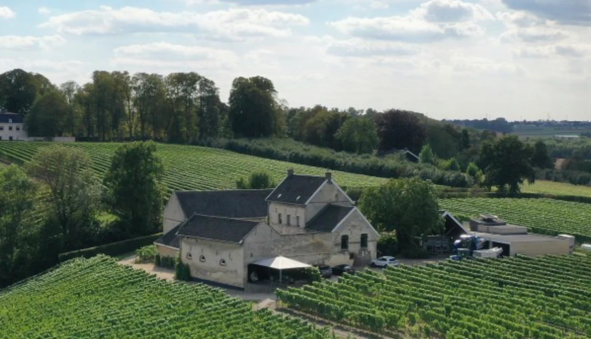
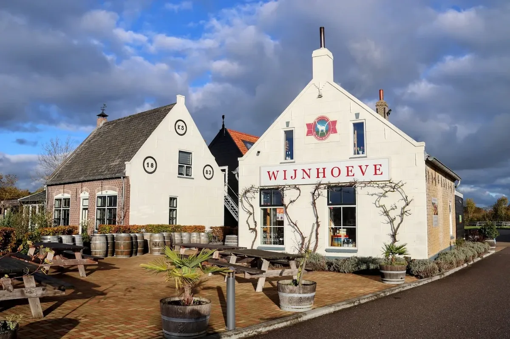
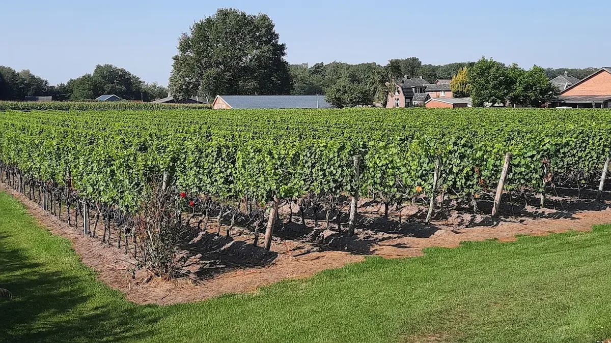
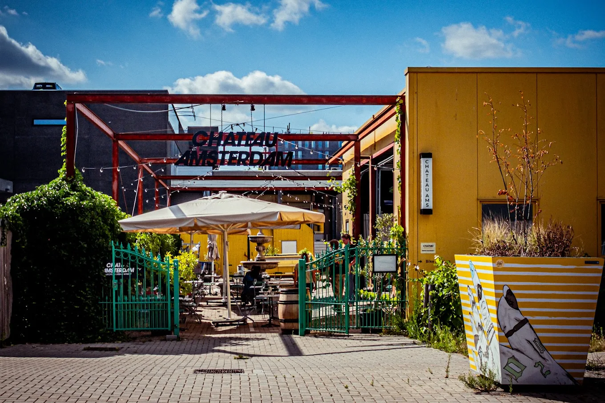

Nederland heeft inmiddels honderden wijngaarden, en de wijn wordt elk jaar beter. Zuid-Limburg heeft de langste traditie, maar ook in Zeeland, de Betuwe, de Achterhoek en zelfs Friesland staan wijnstokken. Veel wijngaarden werken met schimmelresistente druiven, zoals solaris, johanniter en souvignier gris. Die hebben weinig of geen bespuiting nodig. Hieronder de wijngaarden waar je kunt proeven.

## Zuid-Limburg

Op de Louwberg boven het Jekerdal ligt [De Apostelhoeve](/locations/de-apostelhoeve), de oudste wijngaard van Nederland, waar sinds 1970 commercieel wijn wordt gemaakt. Vanuit Maastricht kun je er heen wandelen of fietsen. Aan de andere kant van de stad ligt [Hoeve Nekum](/locations/wijngoed-hoeve-nekum), een carréboerderij van rond 1600, waar sinds 1988 wijnstokken staan.

In Voerendaal maakt [Wijngoed Fromberg](/locations/wijngoed-fromberg) sinds 1994 wijn op een kalkhelling op het zuiden. In 1996 bracht Fromberg de eerste Nederlandse mousserende wijn uit. Je proeft er op een terras met uitzicht, en er is ook een rondleiding met mousserende wijn en chocolade. [Domein Holset](/locations/domein-holset), bij Vaals en het Drielandenpunt, maakt alleen mousserende wijn, in een boerderij die met circulaire materialen is verbouwd.

In Sint Geertruid begonnen Marc en Eedsje Huynen in 2016 met 325 stokken in hun achtertuin. Nu heeft [Wijndomein D'Hunes](/locations/wijndomein-dhunes) zeven hectare met elf druivensoorten. [Wijngoed Raar Saint Remi](/locations/wijngoed-raar-saint-remi) in Meerssen verwijst naar de monniken van Saint-Remi uit Reims, die hier in de middeleeuwen al wijngaarden hadden. Bij [Sterreheim](/locations/sterreheim) in Schinnen staan klassieke druivenrassen rond een negentiende-eeuwse hoeve, en de alpaca's leveren de mest. In het witte stadje Thorn, in Midden-Limburg, vertelt wijnmaker Harry Vorselen in het proeflokaal van [Wijngoed Thorn](/locations/wijngoed-thorn) over het maken van wijn. Probeer daar vooral de witte wijnen.

## Zeeland en de Betuwe

Op Schouwen-Duiveland plantte [De Kleine Schorre](/locations/wijnhoeve-de-kleine-schorre) in 2001 de eerste stokken, met hulp van een Luxemburgs wijnhuis. Er groeien pinot gris, pinot blanc, rivaner en auxerrois, witte wijnen die passen bij Zeeuwse vis en schaaldieren. Met zo'n 63.000 stokken is het een van de grootste wijngaarden van Nederland. In Erichem, bij Buren, heeft het [Betuws Wijndomein](/locations/betuws-wijndomein) zeven hectare met alleen schimmelresistente rassen. Je kunt er het hele jaar wandelen en proeven.

## Het oosten en het noorden

Net buiten Winterswijk ligt [Wijngaard Hesselink](/locations/wijngaard-hesselink), aan het fietsknooppuntennetwerk. Bij de proeverij krijg je vijf wijnen met stokbrood en kaas. In Hilversum maakt [Wijngaard Zonnestraal](/locations/wijngaard-zonnestraal) sinds 2016 wijn, met elke eerste vrijdag van de maand een avond met pizza en wijn. In Twijzel, in Friesland, ligt [De Frysling](/locations/wijngaard-de-frysling), een van de noordelijkste wijngaarden van Nederland. Daar maken ze onder meer de mousserende Brûswyn.

## In de stad

[Chateau Amsterdam](/locations/chateau-amsterdam) in Amsterdam-Noord heeft geen wijngaard. Het is een stadswijnmakerij die druiven uit onder meer Duitsland, Frankrijk en Spanje aan het IJ tot wijn maakt. Er is een proefruimte en een restaurant.

## Tip

Veel Nederlandse wijngaarden zijn alleen in het weekend of op afspraak open, en sommige alleen van het voorjaar tot het najaar. Kijk vooraf op de website. De mousserende wijnen zijn vaak de beste keuze om mee te beginnen. Alle adressen staan ook op de [wijnkaart](/wijnkaart).
