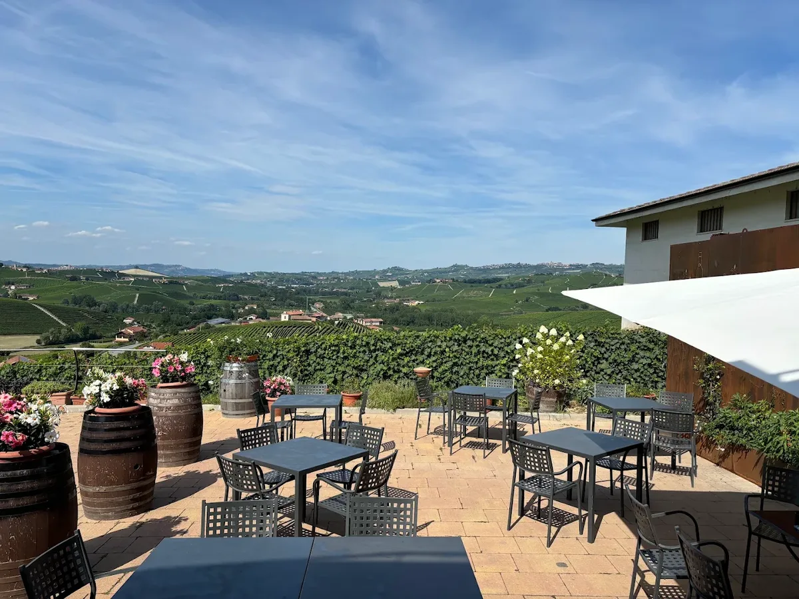
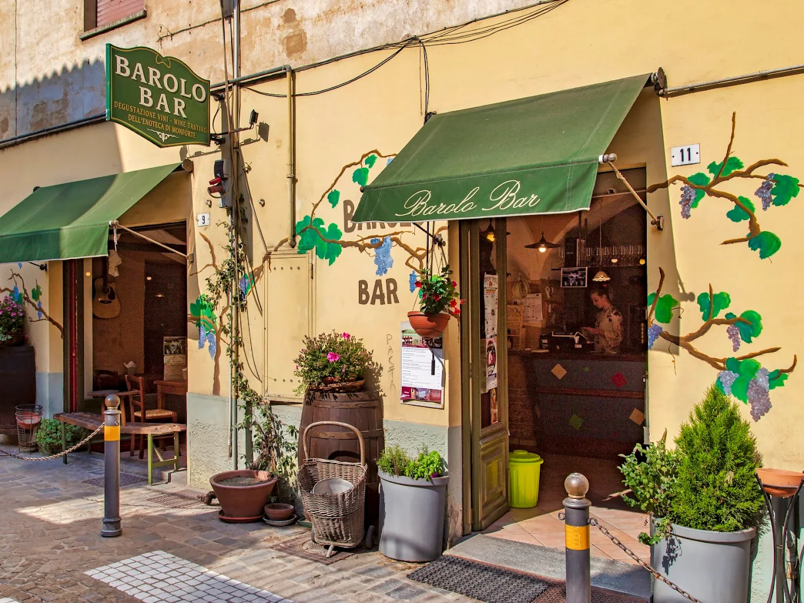
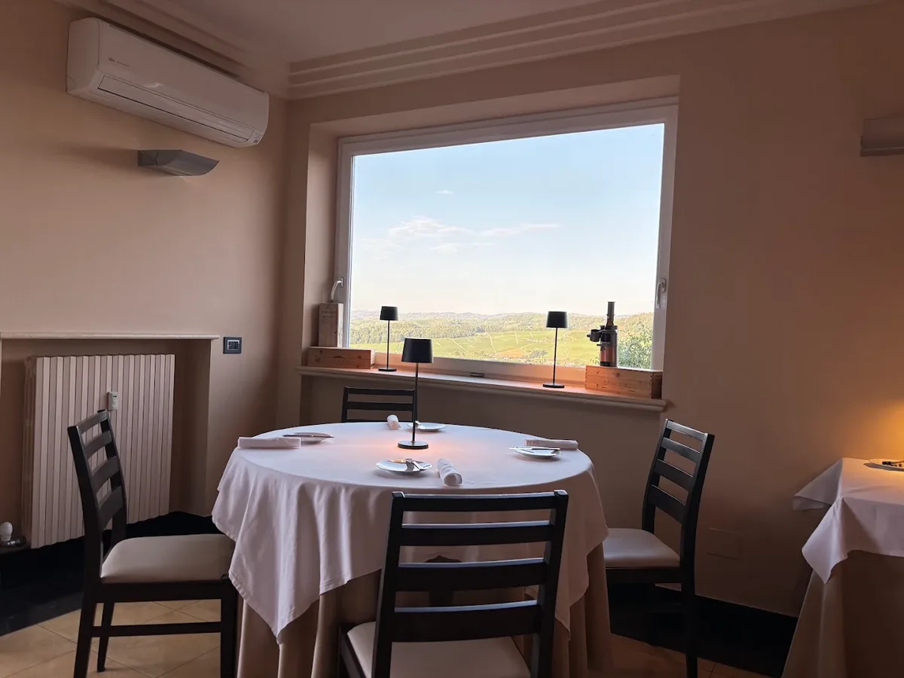
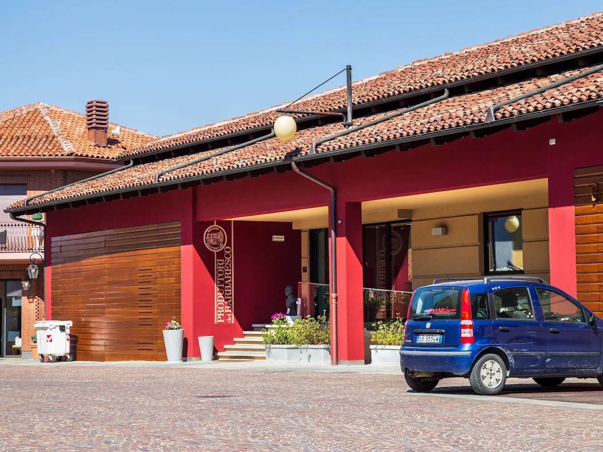
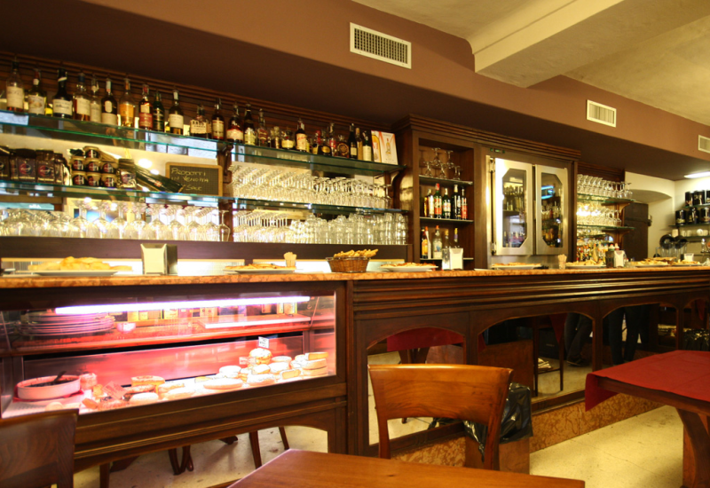

In de Langhe, de heuvels rond Alba, komen de twee bekendste wijnen van Italië vandaan: barolo en barbaresco, allebei van de nebbiolo-druif. De dorpen liggen op een paar kilometer van elkaar, en in elk dorp zitten wel een wijnhuis, een enoteca en een trattoria. Hieronder per dorp waar je naartoe kunt.

## De streek in het kort

Barolo komt uit elf gemeenten ten zuidwesten van Alba en Barbaresco uit drie gemeenten ten oosten ervan. Barolo is meestal krachtiger, met meer tannine, en moet langer rijpen. Barbaresco is vaak wat eleganter. Binnen de Barolo verschillen de dorpen ook: wijn uit La Morra is vaak zachter en geuriger, uit Serralunga d'Alba en Monforte steviger. Naast nebbiolo groeien hier barbera, dolcetto en de witte arneis. In Novello wordt ook weer de witte nascetta gemaakt.

## Barolo en La Morra

In het dorp Barolo staat [Cantina Bartolo Mascarello](/locations/cantina-bartolo-mascarello), het huis van de bekendste traditionalist van de streek, nu gerund door zijn dochter Maria Teresa. Aan de Via Roma heeft [Vinoland](/locations/vinoland) wijnen van grote en kleine producenten, ook oudere jaargangen van twintig tot dertig jaar. Midden in de cru Cannubi ligt [Locanda in Cannubi](/locations/locanda-in-cannubi), met zo'n 825 wijnen en drie pagina's Barolo Cannubi van verschillende producenten. Zo proef je de wijngaard waar je naar kijkt.

In La Morra heeft [Osteria Veglio](/locations/osteria-veglio) een terras met uitzicht over Barolo. De eigenaar haalt soms oudere jaargangen uit de kelder voor dezelfde prijs. [Mauro Molino](/locations/azienda-agricola-mauro-molino) in Annunziata maakt Barolo in een moderne stijl, een goede kennismaking. In hetzelfde gehucht combineert [Agricola Marrone](/locations/agricola-marrone) in de proefruimte elke wijn met een traditioneel gerecht, met uitzicht over de heuvels. Iets verderop schenkt [Alessandro Rivetto](/locations/alessandro-rivetto) in zijn kelder met grote eikenhouten vaten barolo uit Lazzarito en Vigna Rionda. [Dosio](/locations/dosio-vigneti) ligt op 500 meter hoogte, het hoogste punt van de Barolo. Wie fijn wil eten, gaat naar [Belsit](/locations/belsit), met een kelder in de stijl van Gaudí. Traditioneel eten doe je bij [L'Osteria del Vignaiolo](/locations/losteria-del-vignaiolo).

## Monforte, Castiglione Falletto en Serralunga

In Monforte d'Alba drink je bij [Barolo Bar](/locations/barolo-bar) aan het marktplein een glas met antipasti, met een dakterras ertegenover. In het nabijgelegen Bussia schenkt [Cascina Sòt](/locations/cascina-sot) de Barolo Bricco San Pietro, van een familie die als pachters begon voordat ze de boerderij in 1975 kocht. In Castiglione Falletto heeft [Casa Sobrero](/locations/casa-sobrero) een proefruimte en een terras met uitzicht van La Morra tot Serralunga. [Le Torri](/locations/le-torri) op het dorpsplein kijkt uit over de wijngaarden.

In Serralunga d'Alba maakt [Palladino](/locations/azienda-vinicola-palladino) Barolo van eigen wijngaarden in cru's als Vigna Rionda en Cerretta. Elena Penna en Luca Currado begonnen er na 35 jaar bij Vietti een nieuw domein: [Penna-Currado](/locations/penna-currado). Onder het kasteel heeft [Vinoteca Centro Storico](/locations/vinoteca-centro-storico) elke dag drie antipasti, drie primi en drie secondi. Op het landgoed Fontanafredda kookt Ugo Alciati bij [Guido](/locations/guido-ristorante), met een Michelinster en de agnolotti del plin van zijn moeder. Ook in Serralunga heeft [Giovanni Rosso](/locations/giovanni-rosso) een perceel in de legendarische Vigna Rionda en proef je de Barolo's, soms rechtstreeks van het vat, in een moderne kelder.

## Novello en Verduno

Novello is het rustigste Barolo-dorp. Bij [Langotto](/locations/langotto-ristorante) helpt sommelier Elisa Andreotti je kiezen. Vraag naar een glas nascetta en een barolo uit de cru Ravera. Bij [Cogli l'Attimo](/locations/cogli-lattimo) proef je aan picknicktafels onder grote bomen, zonder kelder of receptie. In Verduno, het minst bekende Barolo-dorp, ontvangen de broers van [Fratelli Alessandria](/locations/fratelli-alessandria) je in een oud stenen wijnhuis.

## Barbaresco, Neive en Treiso

In Barbaresco is [Produttori del Barbaresco](/locations/produttori-del-barbaresco) een coöperatie van 53 boeren, opgericht in 1894. [Marchesi di Grésy](/locations/marchesi-di-gresy) heeft de wijngaard Martinenga al sinds 1797. [Ronchi](/locations/azienda-agricola-ronchi) is een klein familiebedrijf met zeven hectare. Je eet er bij [Antica Torre](/locations/antica-torre), een familierestaurant met konijn, truffel en pasta.

In Neive heeft [Al nido della Cinciallegra](/locations/al-nido-della-cinciallegra) op het dorpsplein de oudste enoteca van het dorp, vol lokale wijnen. Ook in Neive proef je bij [Negro Giuseppe](/locations/negro-giuseppe) barbaresco op een panoramaterras over de wijngaarden, met onder meer oude jaargangen uit de eigen collectie. In Treiso ligt [Ca' del Baio](/locations/ca-del-baio) in een natuurlijk amfitheater van wijngaarden, en [Villa Garassino](/locations/villa-garassino) is een agriturismo met uitzicht over de Barbaresco.

## Alba en de omgeving

In Diano d'Alba, op de heuvels tussen Alba en de Barolo-dorpen, serveert [Abrigo Fratelli](/locations/abrigo-fratelli) een verticale proeverij van Barolo Ravera met vleeswaren en hazelnoten van het eigen land. In Alba schenkt [Vincafè](/locations/vincafe) aan de Via Vittorio Emanuele meer dan zestig Piemontese wijnen. [La Piola](/locations/la-piola) op de Piazza Risorgimento is het eenvoudige restaurant van de familie Ceretto, tegenover de kathedraal. Op de Piazza Michele Ferrero heeft de familie Sarotto een wijnbar: [Roberto Sarotto](/locations/roberto-sarotto). Iets verder weg liggen [Poderi Luigi Einaudi](/locations/poderi-luigi-einaudi-azienda-agricola) in Dogliani, waar je ook kunt overnachten, [Trattoria del Peso](/locations/trattoria-del-peso) in Belvedere Langhe, waar je eet wat de pot schaft, en [Le Piemontesine](/locations/le-piemontesine) in de Alta Langa.

## Tip

Kom in het najaar voor de witte truffel uit Alba, of in het voorjaar als het rustiger is. Bij de meeste wijnhuizen moet je van tevoren een afspraak maken. Alle adressen staan ook in de [gids Piemonte](/wijnreis/piemonte).
