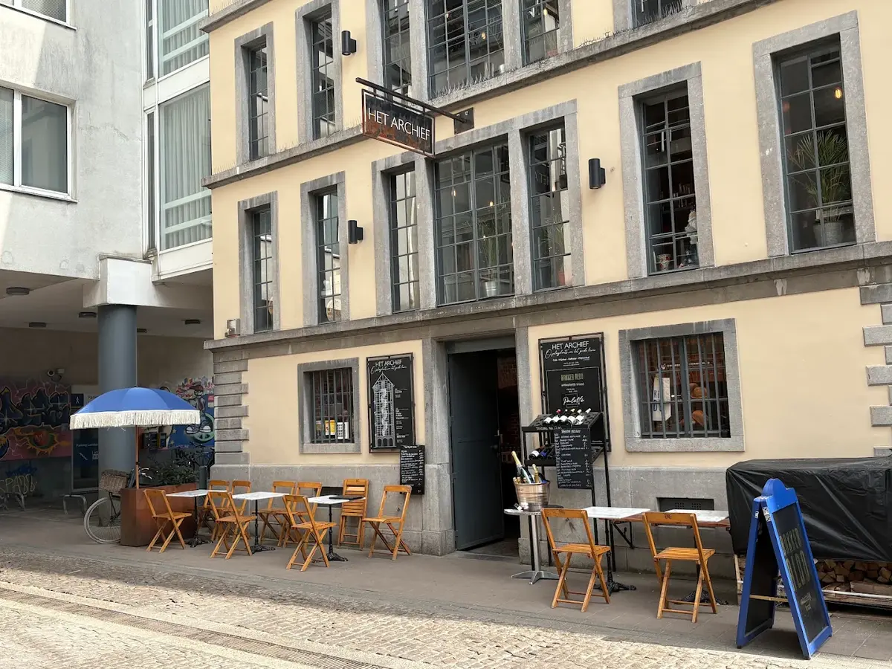
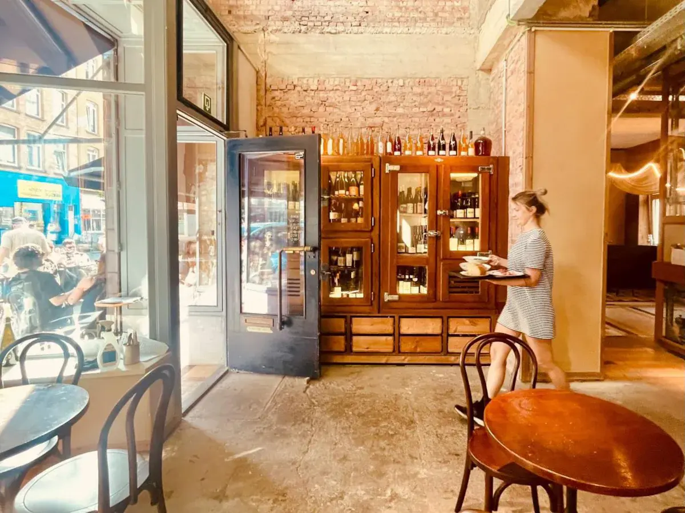

Antwerpen is goed te voet te doen, en de wijnadressen liggen in drie buurten: de binnenstad rond de Meir, het Zuid en het Eilandje bij de haven. Op het Zuid zitten de natuurwijnbars, op het Eilandje de restaurants met grote wijnkaarten. Hieronder per wijk waar je heen kunt.

## De binnenstad

In de Geefsstraat, vlak bij de Meir, zit [Het Archief](/locations/het-archief) in het oude Provinciaal Archief uit 1851. Er staan altijd meer dan 25 wijnen per glas open, en een deel daarvan wisselt elke dag. Aan de Hopland is [Luddites](/locations/luddites-books-wine) een boekwinkel met boven een wijnbar, in een herenhuis uit 1902. Er is geen wifi, en koop je een boek, dan krijg je een glas wijn voor de halve prijs.

In de Schermersstraat verkoopt [Amber Bottle Shop](/locations/amber-bottle-shop) meer dan 400 natuurwijnen, deels uit eigen import, en je kunt er aan de bar ook een glas drinken. Bij [Belgian Wines](/locations/belgian-wines) aan de Oudevaartplaats staat alleen Belgische wijn op de kaart: mousserend, wit, rosé en rood, met kaas en charcuterie uit de streek. Wie wil eten, kan naar [Invincible](/locations/invincible) in de Haarstraat, waar kok en sommelier Kenny Burssens eigentijds Frans kookt aan een lange toog met veel wijn per glas.

## Het Zuid

Op het Zuid zitten twee wijnbars voor wie iets nieuws wil proeven. [Spiridon](/locations/spiridon) in de Kronenburgstraat schenkt vooral natuurwijn, met kleine gerechten zoals kalfstong met salsa verde. Een oude slagerskoelkast dient als wijnkelder. Bij [Ta-nnin](/locations/ta-nnin) in de Volkstraat staan zo'n 25 wijnen per glas open, met klassieke streken naast wijnen uit Midden- en Oost-Europa. De kleine gerechten hebben Japanse, Koreaanse en Italiaanse invloeden.

## Het Eilandje

Op het Eilandje, het oude havengebied, eet je met een uitgebreide wijnkaart. [Marcel](/locations/restaurant-marcel) zit in een voormalige zeemanskerk naast het MAS en heeft zo'n 800 wijnen, waarvan meer dan 40 per glas. In een oud pakhuis aan de Oudeleeuwenrui heeft [Pazzo](/locations/pazzo) een restaurant met honderden wijnen, en een wijnbar erboven met meer dan 170 wijnen, de meeste per glas. [Bistrot L'îlot](/locations/bistrot-lilot) in de Kribbestraat is kleiner: een bistro met dertig plaatsen, een kaart die met de markt wisselt en vooral Franse wijn tegen vriendelijke prijzen.

Op de bovenste verdieping van het MAS ligt [Zilte](/locations/zilte), met drie Michelinsterren en uitzicht over de haven. Sommelier Aaron Moeraert schenkt bij elk gerecht meerdere wijnen per glas, zodat je zelf kunt kiezen.

## Buiten het centrum

In de stadsbrouwerij van De Koninck heeft [The Butcher's Son](/locations/the-butchers-son) een Michelinster. Rood vlees staat centraal, met een wijnkaart van zo'n 400 wijnen uit vooral Frankrijk, Italië en Spanje. In Edegem, op een kwartier rijden, zit [Stable](/locations/stable) in de oude stallen van een kasteel uit de achttiende eeuw, met een flinke Belgische selectie op de wijnkaart.

## Tip

Combineer de wijnbars op het Zuid in één avond: Spiridon en Ta-nnin liggen op een paar minuten lopen van elkaar. Alle adressen staan ook in de [gids Antwerpen](/wijntips/antwerpen).
