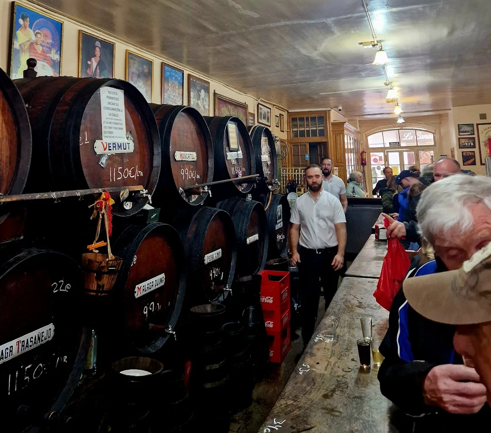
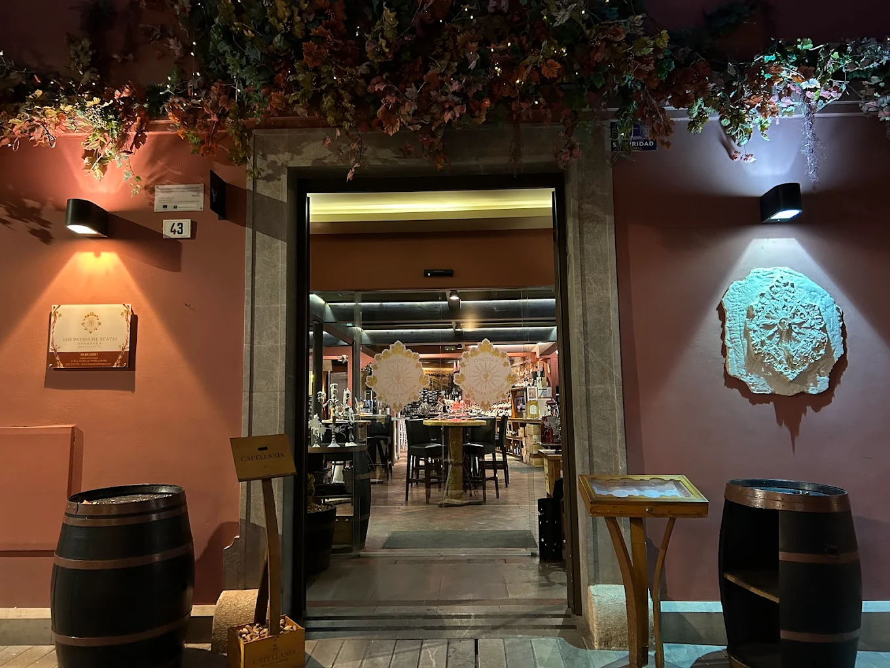

Málaga is vooral bekend om zoete wijn, van moscatel en pedro ximénez. Die drink je nog altijd uit het vat in de oude bodega's van het centrum. Maar in de wijnbars van de stad en in de bergen eromheen vind je ook droge wijn van kleine producenten. Hieronder de adressen in Málaga, de wijnhuizen in de omgeving en de wijnbars in Marbella.

## De klassiekers in het centrum

[Antigua Casa de Guardia](/locations/antigua-casa-de-guardia) aan de Alameda Principal is de oudste wijnbar van Málaga, sinds 1840. Langs de achterwand liggen 24 eikenhouten vaten, en de barmannen tappen de wijn direct in kleine glazen. Je rekening schrijven ze met krijt op de bar. Probeer de pajarete, een halfzoete wijn die typisch is voor Málaga, of de droge seco añejo. Een glas kost zelden meer dan een paar euro.

[El Pimpi](/locations/el-pimpi), in een 18e-eeuws herenhuis tegenover het Romeinse theater, is een beetje toeristisch, maar altijd gezellig. De kaart draait om wijnen uit Málaga en de Sierras de Málaga, van producenten als Doña Felisa en Jorge Ordóñez. Bestel een vino dulce. Bij [La Tranca](/locations/la-tranca) in de Calle Carretería drink je de huisgemaakte vermouth, tussen klassieke tapas en een luid publiek.

## Wijnbars voor nieuwe ontdekkingen

[Los Patios de Beatas](/locations/los-patios-de-beatas), vlak bij het Picassomuseum, heeft meer dan 600 wijnen, waarvan meer dan 50 per glas, in twee gerenoveerde panden met patio's. Bij [Vertical](/locations/vertical) bestel je niet zomaar een glas: sommelier Julio Barluenga vraagt eerst wat je lekker vindt en laat je dan wijnen van kleine producenten proeven. Reserveer, want de zaak is klein.

[Descorche](/locations/descorche) in de Calle Álamos heeft veel wijnen uit Málaga en naturelwijn, en de kleine gerechten zijn afgestemd op de wijn. Kom je hier, dan proef je eens iets anders dan de bekende Rioja en Ribera del Duero. Bij [Vinoteca Bouquet](/locations/vinoteca-bouquet) aan de Alameda krijg je bij elke wijn uitleg van de twee Cubaanse broers die de zaak runnen. [Anyway Winebar](/locations/anyway-winebar) bij de haven schenkt vooral Spaanse wijn, met veel per glas, van sherry tot rood. Wie wil eten, kan naar [Araboka](/locations/araboka) bij de kathedraal: de kaart heeft veel wijnen uit de provincie Málaga, en bij het menu krijg je een zoete Málagawijn bij het dessert.

Voor een fles om mee te nemen ga je naar [Crespillo Innova](/locations/crespillo-innova), een wijnwinkel en slagerij in één. Spaanse topwijnen kosten hier een stuk minder dan in Nederland.

## Wijnhuizen rond Málaga

[Bodegas Quitapenas](/locations/bodegas-quitapenas) in Churriana, sinds 1880 en nu in handen van de vijfde generatie, ligt vlak bij de luchthaven. Je proeft er drie of vier wijnen, eventueel met kaas of Ibérico-ham. In de Axarquía, ten oosten van Málaga, liggen de wijngaarden op steile hellingen. [Bodegas Bentomiz](/locations/bodegas-bentomiz) in Sayalonga werd opgericht door een Nederlands stel en ligt op 500 tot 800 meter hoogte, met uitzicht op zee. [Fabio Coullet](/locations/bodega-fabio-coullet) in Almáchar maakt droge wijnen van oude lokale druiven, zoals de bijna vergeten romé. Dat is bijzonder in een streek die vooral om zoete wijn bekend is. Ook [Bodegas Jorge Ordóñez](/locations/bodega-ordonez) in Vélez-Málaga, gespecialiseerd in moscatel, ontvangt bezoekers op afspraak.

In de bergen bij Ronda ligt [Bodega Doña Felisa](/locations/bodega-doña-felisa) op zo'n 900 meter hoogte, vlak bij de Romeinse ruïnes van Acinipo. De rondleiding duurt anderhalf uur, met een proeverij en hapjes. Bij Manilva, aan de kust, redt [Nilva](/locations/nilva-enoturismo) de oude moscatelstokken; de proeverij is in een wijngaard met uitzicht op Gibraltar en de Afrikaanse kust.

## Marbella

In Nueva Andalucía heeft sommelier Emilio Campos [Adivino](/locations/adivino): wijnbar, wijnwinkel en galerie in één ruimte, met begeleide proeverijen, ook blind. [G-Wine](/locations/g-wine-bar-and-grill) in San Pedro schenkt meer dan 25 wijnen per glas, zeven dagen per week. Bij [Lobito de Mar](/locations/lobito-de-mar) eet je vis en blauwvintonijn, in zeventien bereidingen, met een serieuze wijnkaart. En [Cascada](/locations/cascada), in de heuvels van de Sierra Blanca, heeft een menu van vijf gangen met een wijnarrangement van €30.

## Tip

Proef in Málaga de wijnen uit de streek zelf, zoet en droog. Veel restaurants schenken vooral bekende wijnen uit Rioja en Ribera del Duero, terwijl de wijnen uit de eigen provincie een stuk interessanter zijn. Alle adressen staan ook in de [gids Málaga & Marbella](/wijnreis/malaga).
