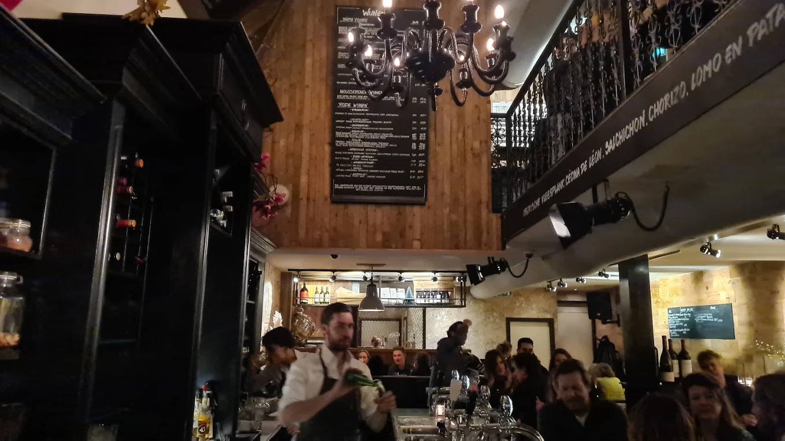
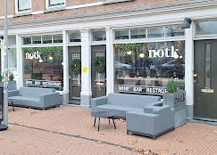
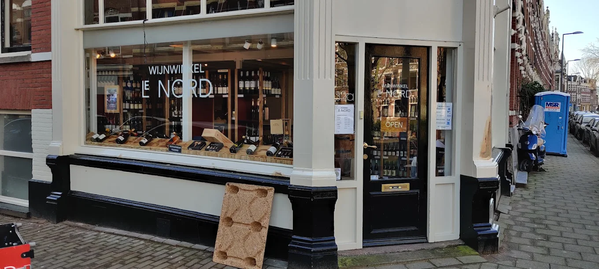
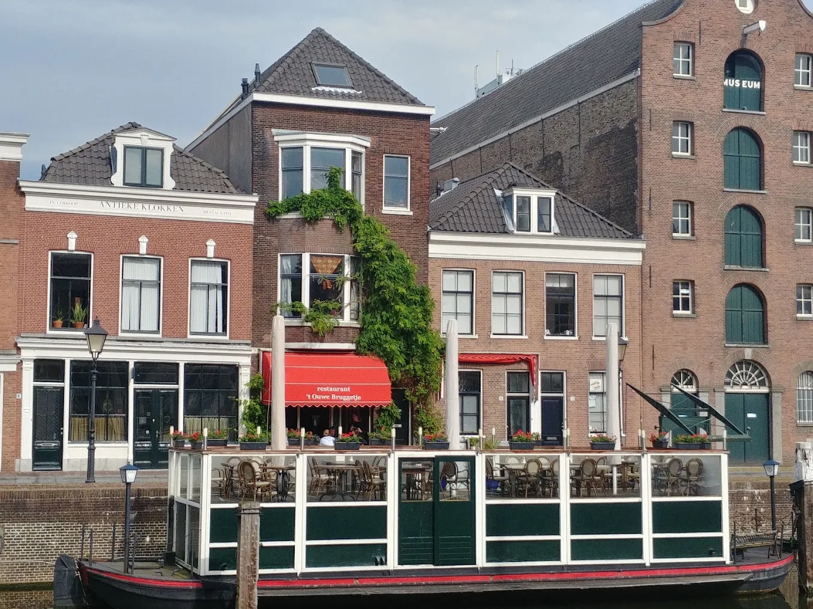

Rotterdam heeft veel wijnbars, verspreid over de stad. In het centrum vind je de klassiekers met grote kaarten, op Katendrecht en in het Oude Noorden vooral natuurwijn. Hieronder per buurt waar je heen kunt.

## Centrum

[Wijnbar Het Eigendom](/locations/wijnbar-het-eigendom) opende in 2011 als eerste wijnbar van de Witte de Withstraat, in een pand uit de jaren veertig. Er staan 135 wijnen op de kaart, waarvan 35 per glas, en meer dan twintig kleine gerechten. Aan de Hoogstraat schenkt [Café Verward](/locations/cafe-verward) veel natuurwijn zonder vaste wijnkaart: Ward vraagt wat je lekker vindt en schenkt dan in. Aan de Goudsesingel zitten [Bar Bocht](/locations/bar-bocht), met natuurwijn en champagne van kleine producenten, en [Wijnkoperij Platenburg](/locations/wijnkoperij-platenburg), een wijnwinkel van bijna 130 jaar oud met meer dan 1.000 wijnen. Naast de winkel kun je in de wijnbar Proef dagelijks bijzondere wijnen per glas drinken.

Vlak bij Rotterdam Centraal kies je bij [L'Ouest](/locations/louest) een wine flight: drie wijnen met hapjes en uitleg, vaak uit minder bekende streken. Bij [Vineum](/locations/vineum) aan de Eendrachtsweg staan meer dan 1.750 wijnen op de kaart. Dankzij de Coravin kun je ook dure wijnen per glas proeven, beneden in de wijnbar of boven in het restaurant. Aan de Veerhaven heeft [Louise Petit](/locations/louise-petit-restaurant) een Franse bistro met een aparte Bar à Vins, waar je een glas Loire of champagne drinkt met een kaasplank.

## Katendrecht en de Kop van Zuid

Op Katendrecht is [NOTK](/locations/notk) aan de Delistraat restaurant, wijnbar en wijnwinkel tegelijk. Een paar deuren verder heeft [De Matroos en het Meisje](/locations/de-matroos-en-het-meisje) een kleine wijnkaart met vooral biologische en natuurwijn, veel champagne en Bourgogne, en altijd halve glazen. Sommelier Taco de Vos heeft ook [Eetcafé 't Meisje](/locations/eetcafe-t-meisje) aan de Brede Hilledijk, waar je zonder reservering binnenloopt voor een glas en een bord comfortfood. Onder het Entrepotgebouw zit [Tres](/locations/tres), met een Michelinster en zestien plaatsen aan de bar.

## Het Oude Noorden, Blijdorp en Kralingen

In de Proveniersstraat zitten twee adressen naast elkaar. [Le Nord](/locations/le-nord) is beneden een wijnwinkel en boven een proeflokaal, met elke maand een open proeverij. Bij [Café Kiem](/locations/cafe-kiem) drink je natuurwijn bij lokaal en seizoensgebonden eten. Om de hoek, bij [Klaargemaakt](/locations/klaargemaakt) aan de Schiekade, staat ook veel natuurwijn op de kaart, naast zelfgemaakte gefermenteerde dranken.

Bij [Walsjérôt](/locations/wijnbar-walsjerot) in Blijdorp laad je een pasje op en tap je zelf: een slokje, een half of een heel glas, uit meer dan 70 wijnen. In Kralingen heeft [Juni](/locations/juni-rotterdam) wijn en kaas als gelijkwaardige partners. Je kunt er niet reserveren, dus je loopt gewoon binnen. [LUX](/locations/lux) aan de 's-Gravendijkwal schenkt uitsluitend natuurwijn, bij een menu van vier gangen.

## Delfshaven

In Historisch Delfshaven runnen Fred en Monique Zywiecki al sinds 1989 ['t Ouwe Bruggetje](/locations/t-ouwe-bruggetje), met een terras aan het water. Vrijwel alle wijnen komen uit hun eigen import, en wat je bij het eten drinkt, kun je daarna kopen in de wijnwinkel ernaast.

## Tip

Veel van de natuurwijnbars in Rotterdam zijn klein, en sommige werken zonder reservering. Kom op tijd. Alle adressen staan ook in de [gids Rotterdam](/wijntips/rotterdam).
