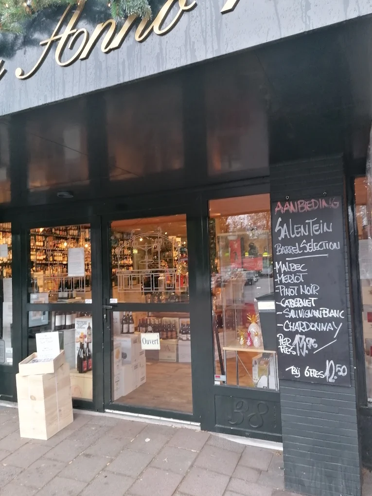
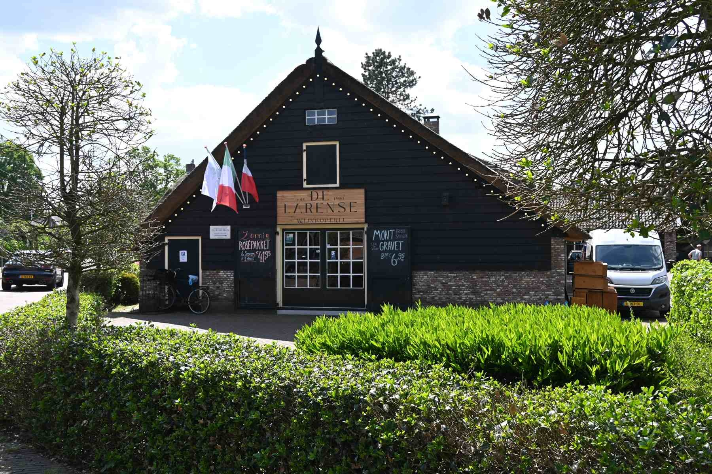
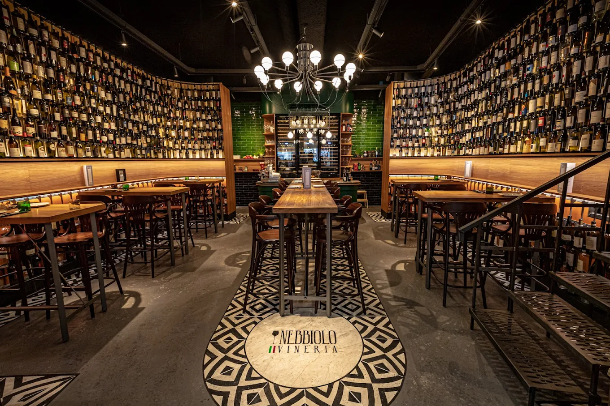

't Gooi is klein, maar je vindt er veel goede wijnadressen. Bussum en Laren hebben elk een paar wijnwinkels met een groot assortiment. In Blaricum en Baarn zitten wijnbars waar je veel per glas kunt proeven. Hieronder per plaats waar je naartoe kunt.

## Bussum

In het centrum van Bussum zit aan de Kerkstraat [The Winebar](/locations/the-winebar), van dezelfde eigenaar als A-Fusion, dus er is ook goed eten. De wijnkaart is eenvoudig, maar vraag naar het notitieboekje: daarin staan een paar topwijnen. Om de hoek, in de Kapelstraat, schenkt [de Buren](/locations/de-buren) originele wijnen, zoals een nebbiolo uit Zuid-Afrika, naast bekende namen. Ze rekenen een vaste toeslag per fles, waardoor een mooie fles betaalbaar blijft.

Voor een fles voor thuis ga je naar de [Bussumsche Wijnkooperij](/locations/bussumsche-wijnkooperij) in de Spiegelstraat. Naast een groot assortiment wijn hebben ze ook oudere jaargangen en topwijnen. Vraag naar Howard voor advies over wijn bij eten. [Wijnhandel Eduard Mol](/locations/wijnhandel-eduard-mol) aan de Huizerweg is al lang een begrip in Bussum. De winkel is een beetje rommelig, maar er staat altijd iets open om te proeven.

## Laren en Blaricum

[De Larense Wijnkoperij](/locations/de-larense-wijnkoperij) zit in een monumentale boerderij aan de Torenlaan, met meer dan 600 wijnen, waarvan veel uit eigen import. Bij [Visatelier](/locations/visatelier-laren) in Laren zitten een visspeciaalzaak, een restaurant en een wijnbar onder één dak. In de wijnbar drink je bubbels of witte wijn, ook zonder te eten.

In Blaricum schenkt [Ottovino](/locations/ottovino) aan de Dorpsstraat meer dan dertig wijnen per glas. Eigenaar Otto haalt de wijnen zelf op bij de wijnhuizen, vaak kleine producenten, en je kunt je favoriete fles direct meenemen. Ook [Wexxs](/locations/wexxs) zit in een boerderij, aan de Torenlaan in Blaricum. Aan het eind van de dag staat er vaak iets open om te proeven. Wil je uit eten, dan is er [Bistrôt Chapeau](/locations/bistrôt-chapeau) aan de Huizerweg voor Franse bistrogerechten, of [Rust Wat](/locations/rust-wat-by-sidney-schutte) aan de Schapendrift voor een Franse brasserie met vis en gerijpt vlees.

## Baarn, Hilversum en Huizen

[Vineria Nebbiolo](/locations/vineria-nebbiolo) in Baarn heeft 450 Italiaanse wijnen, van Trentino-Alto Adige tot Sicilië, met een menu uit de Italiaanse keuken dat elke week wisselt. Per fles betaal je een vaste opslag van €15 boven de winkelprijs. In Hilversum is [Gastrovino Mijn Hemel](/locations/gastrovino-mijn-hemel) een wijnwinkel met een wijncafé: je proeft eerst per glas en neemt daarna een fles mee. Aan de rand van Hilversum ligt [Wijngaard Zonnestraal](/locations/wijngaard-zonnestraal), de enige wijngaard in 't Gooi, met de eerste oogst in 2016. Er zijn regelmatig evenementen, zoals elke eerste vrijdag van de maand een avond met pizza en wijn. In Huizen verkoopt [Siersma Wijnadvies](/locations/siersma-wijnadvies) onder meer de eigen Skaap-wijnen uit Zuid-Afrika.

## Rond 't Gooi

Aan de sluis in Muiden zit [Wijnbar Vijf](/locations/wijnbar-vijf), met wijnen van kleine wijnhuizen en een uitgebreide kaart met gerechten om te delen. In Weesp heeft [Somm](/locations/somm-bistro-à-vin) meer dan 250 wijnen, van betaalbaar tot exclusief. In Vreeland en Loenen aan de Vecht zitten twee restaurants met een Michelinster: [De Nederlanden](/locations/de-nederlanden), met een brede wijnkaart, en ['t Amsterdammertje](/locations/t-amsterdammertje), met uitsluitend biologische wijnen.

## Tip

Veel wijnwinkels in 't Gooi hebben aan het eind van de week iets open om te proeven. Combineer een bezoek met een borrel in een van de wijnbars. Alle adressen staan ook in de [gids 't Gooi](/wijntips/t-gooi).
