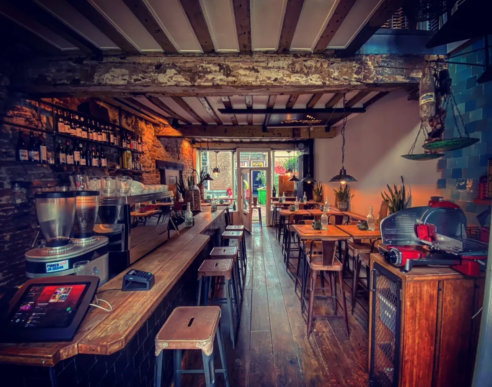
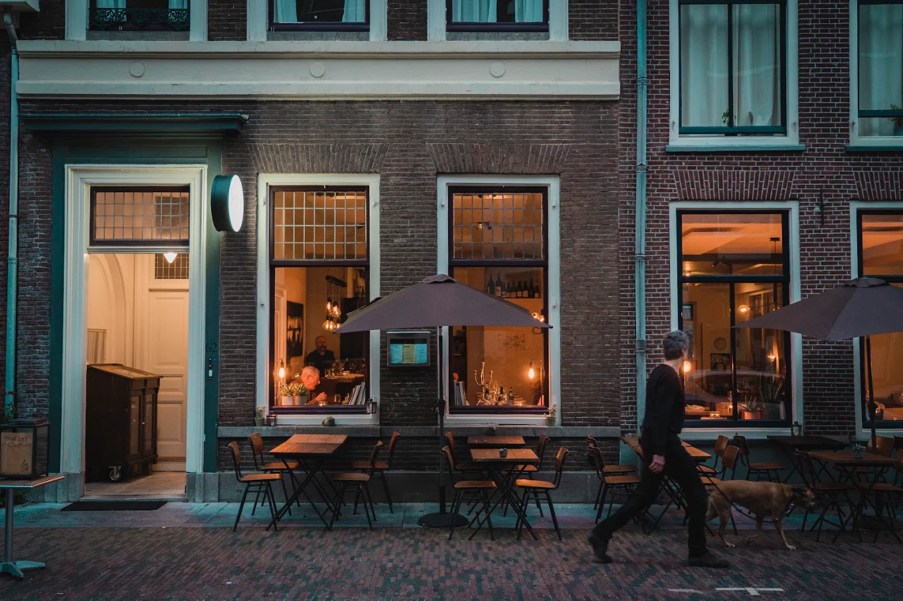

In Utrecht liggen de meeste wijnbars op loopafstand van elkaar, rond de Dom, de Neude en de Oudegracht. Veel ervan schenken natuurwijn, en in Utrecht-Oost zitten twee wijnwinkels die zich daarin hebben gespecialiseerd. Hieronder de adressen, per soort.

## Wijnbars rond de Neude en de Dom

[VinVin](/locations/wijnbar-vinvin) in de Predikherenstraat, sinds 2016, heeft geen gedrukte wijnkaart: het personeel helpt je kiezen uit ruim dertig wijnen van Franse, Italiaanse en Spaanse producenten die zo min mogelijk ingrijpen. Aan de Neude schenkt [Wijncafé Lefebvre](/locations/wijncafé-lefebvre) 27 wijnen per glas in drie prijsklassen, en je mag eerst een paar wijnen proeven. In de Lange Jansstraat zit [Wijnbar Kurk](/locations/wijnbar-kurk), een kleine wijnbar met oude houten kasten. Het team neemt je glas voor glas mee door de kaart. Op vrijdag en zaterdag kun je alleen binnenlopen.

Tussen het Domplein en de Oudegracht heeft [Talud9](/locations/talud9) meer dan 50 wijnen per glas, vooral uit Europa en voor een deel naturel. Aan 't Wed, vlak bij de Dom, heeft [Bar Bet](/locations/bar-bet) zo'n 250 flessen en 30 wijnen per glas, met klassiekers en naturel door elkaar en een terras aan het water.

## Aan de grachten

Aan de Oudegracht zit [VINO](/locations/wijnbar-vino) in de Winkel van Sinkel, het eerste warenhuis van Nederland. Er staan meer dan 140 wijnen op de kaart, en je kunt een high wine met vijf wijnen en vijf gerechten bestellen. [Jacob's](/locations/jacobs-wine-gastrobar-union-house) in Union House kijkt uit op het oude Tivoli en heeft naast bekende namen ook een paar originele wijnen. Aan de Nieuwegracht heeft [Proeflokaal de Lindebar](/locations/proeflokaal-de-lindebar) bijzondere wijnen, maar ook whisky, port en jenever. Een paar keer per maand kun je zonder reservering binnenlopen voor een proeverij.

## Eten met een goed glas

Bij [Café-Restaurant Terroir](/locations/café-restaurant-terroir) in het Museumkwartier kies je eerst je wijn en dan je gerecht. Er staan zo'n 500 wijnen op de kaart, met een vaste marge per fles en veel Duitse wijn, Bourgogne en naturel. [Rosie](/locations/rosie) aan het Lucasbolwerk is half restaurant, half bar, met veel natuurwijn en oesters aan de bar. In het Polman's Huis heeft [Hemel & Aarde](/locations/hemel-aarde) een restaurant en een wijnbar, met wijnen die met de seizoenen meewisselen. [Bistro Madeleine](/locations/bistro-madeleine) aan 't Wed is een Franse bistro met een lange bar, ook voor een glas met een hapje. Bij [San Siro](/locations/san-siro) aan het Oudkerkhof is de kaart grotendeels Italiaans, en bijna alles is per glas.

Iets buiten het centrum zitten [Restaurant Badhuis](/locations/restaurant-badhuis), in een badhuis uit 1927 met gerechten van de grill boven open vuur, en [De Watertoren](/locations/restaurant-de-watertoren) in Rotsoord, met uitzicht over de stad. Bij [Vondels Chefs Bar](/locations/vondels-chefs-bar) in de Dichterswijk is er bewust geen vast wijnarrangement: de bediening helpt je zelf iets te ontdekken.

## Wijnwinkels

In de Nachtegaalstraat in Utrecht-Oost zitten twee wijnwinkels een paar huizen van elkaar. [Vleck](/locations/vleck-wijnen) verkoopt natuurwijn van kleine wijnmakers. Er staan ook veel heldere, klassiek smakende flessen, en op vrijdag is er vaak een kleine proeverij. Bij [Chatobi](/locations/chatobi) liggen alleen wijnen van kleine wijnhuizen die de eigenaar zelf heeft bezocht en geproefd.

In de binnenstad heeft [De Vinotheek](/locations/de-vinotheek) in de Hardebollenstraat zo'n tachtig biologische en natuurwijnen, van dezelfde eigenaar als VinVin. [Utregs Wijnhuis](/locations/utregs-wijnhuis) zit achter de Dom en heeft van alles, van een fles voor elke dag tot exclusieve wijn. [Welkom aan Tafel](/locations/welkom-aan-tafel) in de Lange Smeestraat is een importeur met meer dan 50 Europese wijnhuizen en een proefkelder onder de winkel.

## Tip

Veel wijnbars in de binnenstad zijn klein, en in het weekend kun je soms niet reserveren. Kom vroeg of loop er een paar langs. Alle adressen staan ook in de [gids Utrecht](/wijntips/utrecht).
