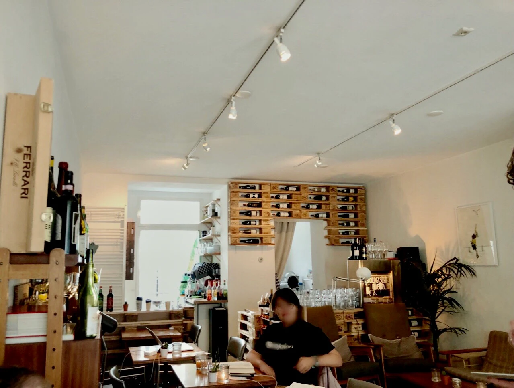
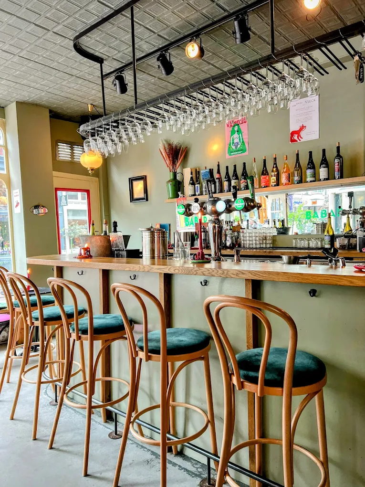
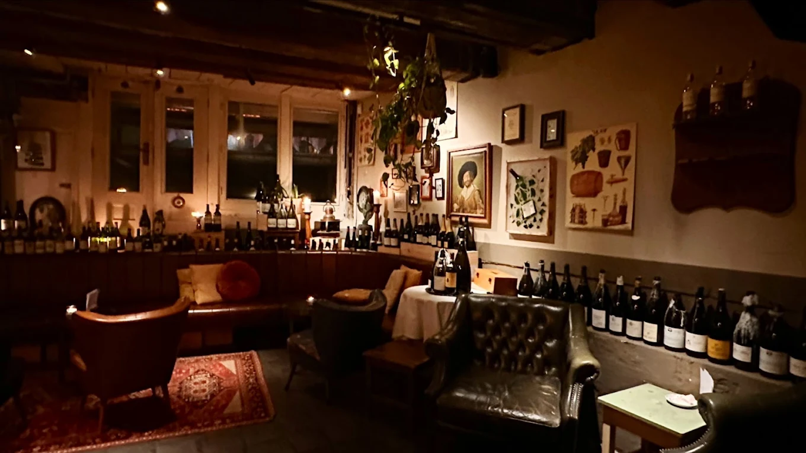
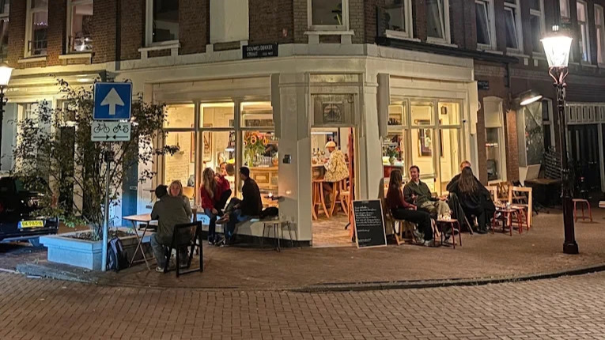
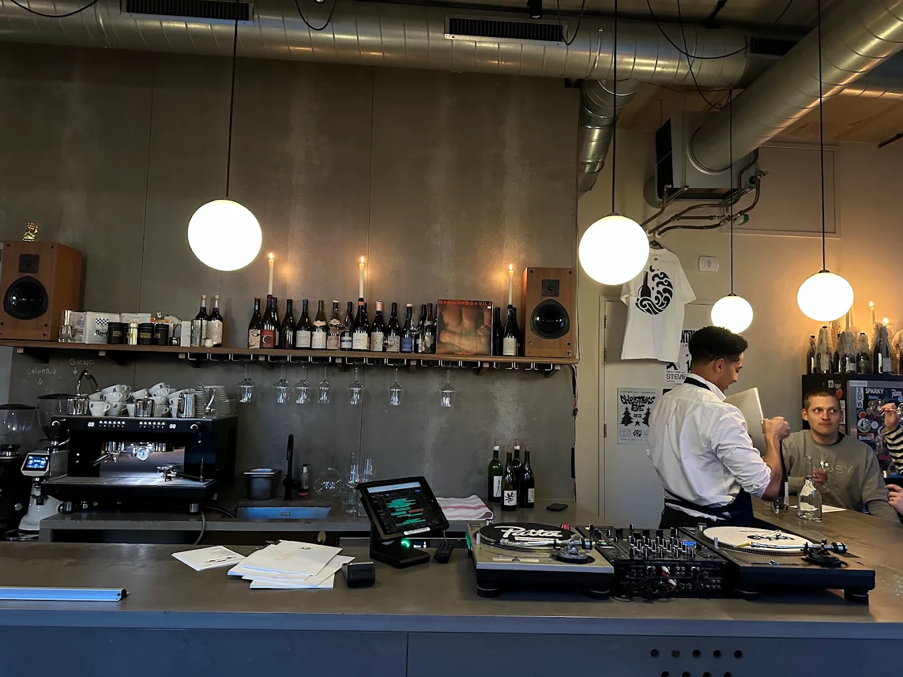

Amsterdam heeft inmiddels tientallen wijnbars, en elke wijk heeft zijn eigen karakter. In De Pijp drink je vooral naturel, rond de grachten zitten de wijnbars met grote kelders, en in Oost en Noord combineer je een glas met een fles voor thuis. Hieronder de wijnbars die wij aanraden, per buurt.

## De Pijp: naturel en klassiekers

In De Pijp opende in 2015 [GlouGlou](/locations/glouglou-1), de eerste naturelwijnbar van Nederland. Er staat uitsluitend vin naturel op de kaart, en je zit op een klein terras tussen de bloemen. Om de hoek, aan de Ceintuurbaan, zit [Wijnbar Paulus](/locations/wijnbar-paulus), al meer dan tien jaar een vaste waarde: een retro huiskamer met acht tot tien witte en rode wijnen per glas, uitsluitend Europees, met vondsten uit Griekenland, Israël en Libanon. In de Lutmastraat zit [Wijnbar Paskamer](/locations/wijnbar-paskamer), gelieerd aan de Amsterdam Wine Academy; vanaf vier personen kun je er een proeverij boeken.

## Rond de Utrechtsestraat en het Frederiksplein

[Bar Babar](/locations/bar-babar) aan de Utrechtsestraat voelt als een kleine Parijse bistro: naturelwijnen, kaarslicht en bijna alles per glas. De eigenaren werken met Amsterdamse leveranciers, van het brood van Mater tot de wijnen van Pieksman en Vleck. Een paar honderd meter verderop, aan het Frederiksplein, mengt [Oocker](/locations/oocker) originele wijnen met bekende toppers, ook veel per glas.

## De grachten en het centrum: grote kelders

Aan de Prinsengracht zit in het souterrain van [Sinck](/locations/sinck) een wijnbar met zo'n 400 wijnen, vooral Frans, voor elk budget; sommelier Sabas Joosten werkte eerder bij De Librije. [Weinlokal Stern](/locations/weinlokal-stern) aan de Singel is zo Duits als het kan: van moezelriesling tot spätburgunder uit Baden, met schnitzel en spätzle erbij. [Bar du Champagne](/locations/bar-du-champagne) aan het Rokin schenkt uitsluitend champagne, uit een kelder van meer dan 450 etiketten, met oesters en zeevruchten erbij. Aan de Lijnbaansgracht heeft [Wijnbar Shiraz](/locations/wijnbar-shiraz) een brede kaart met veel per glas, zelfs een tawny port van 40 jaar. En op de Zeedijk schenkt [Vermeers Wijnkamer](/locations/vermeers-wijnkamer) bij elk hapje twee wijnen: één onder de tien euro en één duurder.

## Oud-West: buurtbars met karakter

In Oud-West runt de Fransman Paco [Bar François](/locations/bar-françois) in zijn eentje, van de keuken tot de wijnkaart, met Zuid-Franse gerechten die wekelijks wisselen. Aan de Wilhelminastraat combineert [Barrica](/locations/barrica) Spaanse en internationale wijnen met tapas, op een van de fijnste terrassen van de buurt.

## Oost en Noord: wijnbar en wijnwinkel tegelijk

[Bottleshop](/locations/bottleshop) aan de Wibautstraat kiest radicaal voor naturel, met daarnaast sake, cider en champagne. Bij [Clos](/locations/clos) aan het Beukenplein kun je kiezen uit veel betaalbare wijnen per glas en een high wine van drie tot vijf gangen. Steek je het IJ over, dan vind je in Noord [Wijnbar Vindict](/locations/wijnbar-vindict): meer dan 50 wijnen per glas en ruim 800 per fles, die je ook meteen mee naar huis kunt nemen.

## Tip

Veel van deze wijnbars zijn klein en zitten 's avonds snel vol. Reserveer als dat kan, of kom vroeg op de avond. Alle adressen vind je ook op de [wijnkaart](/wijnkaart) en in de [gids Amsterdam](/wijntips/amsterdam).
