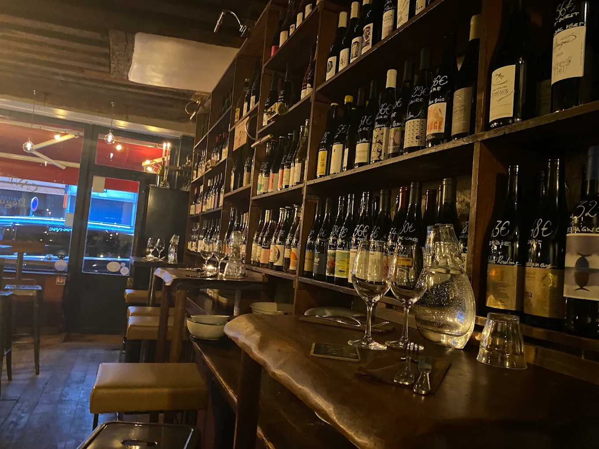
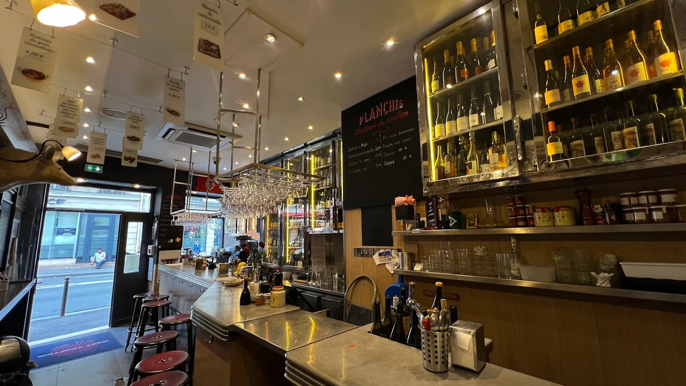

Parijs is een van de beste steden ter wereld om wijn te drinken, en sinds de jaren 2000 ook de stad van de natuurwijn. In bijna elke wijk zit een kleine bar à vins waar je per glas drinkt bij een plank kaas en charcuterie. Hieronder de adressen die wij aanraden, van natuurwijnbars tot de grote wijnwinkels.

## Natuurwijn

[Garde Robe](/locations/garde-robe) in de Rue de l'Arbre Sec, vlak bij het Louvre, is sinds 2006 een van de eerste natuurwijnbars van Parijs. De zaak is klein, en er zitten veel vaste klanten. In Belleville heeft Julien Maillet in een oud wedkantoor [Liquiderie](/locations/liquiderie-bar) gemaakt: meer dan 400 natuurwijnen en 200 bieren, met een hele wand vol taps en lage prijzen. Bij [Septime](/locations/septime) in de Rue de Charonne staan veel biodynamische en natuurwijnen op de kaart. Voor het restaurant moet je ruim van tevoren reserveren, maar je kunt ook terecht in Septime La Cave, de wijnbar om de hoek.

## Bars à vins in de wijken

In de Haut-Marais is [Le Barav](/locations/le-barav) al meer dan vijftien jaar een buurtadres. Er zijn 250 wijnen, en een fles uit de winkel ernaast drink je aan de bar voor een klein kurkengeld. Aan de voet van de Sacré-Cœur kiest [Les Piqueurs](/locations/les-piqueurs) per Franse appellation één wijnmaker, meestal biologisch of biodynamisch, met een plank kaas en charcuterie erbij. In het 9e arrondissement heeft [Duvin](/locations/duvin) een ruime, eerlijk geprijsde kaart met wijnmakers als Jean Foillard en Emmanuel Reynaud, en Franse bistroklassiekers. [La Cave Pigalle](/locations/la-cave-pigalle) is de wijnwinkel van 228 Litres, met meer dan 2.000 wijnen, veel champagne van growers en natuurwijn.

Bij het Odéon zitten drie [Avant Comptoirs](/locations/lavant-comptoir-de-la-terre-et-mer) naast elkaar: Terre, Mer en Marché. Er zijn geen tafels en je kunt niet reserveren. Je staat aan de bar met een glas en kleine hapjes, zoals oesters bij Mer. [Willi's Wine Bar](/locations/le-willis-wine-bar) bij het Palais-Royal draait om Franse wijn, vooral uit de Rhône, met een bistro erbij.

## Wijnwinkels

Vlak bij het Palais-Royal heeft [Legrand Filles et Fils](/locations/legrand-filles-et-fils) veel Bourgogne, Rhône en Loire, met een aparte zaal voor Bordeaux. Op vrijdag en zaterdag zijn er vaak gratis proeverijen. Bij [Caves Augé](/locations/caves-augé) aan de Boulevard Haussmann staan 3.000 tot 4.000 wijnen. Eén keer per maand schenken wijnmakers hun eigen wijn tijdens een gratis proeverij op de stoep. [Lavinia](/locations/lavinia) aan de Avenue Victor Hugo is met meer dan 6.500 wijnen de grootste wijnwinkel van Parijs. Uit de wijnautomaten op de begane grond proef je kleine slokjes, van huiswijn tot grand cru.

## Tip

Veel kleine wijnbars in Parijs werken zonder reservering. Kom vroeg op de avond, rond zes uur. Combineer de wijnwinkels met een bar in dezelfde buurt: Legrand en Willi's liggen op een paar minuten lopen van elkaar, net als La Cave Pigalle en Duvin. Alle adressen staan ook in de [gids Parijs](/wijntips/parijs).
